# 🎬 How I Built My Own Trading Research Team Using Grok Bots (Beginner Tutorial)

> **Chaîne** : [Alex Carter](https://www.youtube.com/@AlexCarterTrading)  
> **Lien YouTube** : [https://www.youtube.com/watch?v=mnIcZVqP9ck](https://www.youtube.com/watch?v=mnIcZVqP9ck)  
> **Date de publication** : 20261021  
> **Durée** : 00:15:01  
> **Identifiant vidéo** : `mnIcZVqP9ck`  
> **Transcription & Analyse** : `whisper-v3-large-turbo+gemini-3.5-flash-lite`  

---

## 📌 Synthèse Exécutive & Outils

### 💡 Résumé

Bienvenue dans cette analyse quantitative de pointe pour la chaîne Alex Carter. La vidéo met en lumière une révolution dans l'automatisation du trading grâce aux **Grok Bots**, un framework d'agents autonomes propulsé par les modèles xAI et conçu pour s'affranchir des contraintes des chatbots conversationnels traditionnels. Contrairement aux IA classiques qui nécessitent une sollicitation manuelle, ces agents fonctionnent en arrière-plan 24h/24 et 7j/7, jouant le rôle d'une véritable équipe de recherche et de gestion de portefeuille automatisée sans qu'aucune compétence en codage ne soit requise.

L'analyse démontre comment configurer une cellule de recherche opérationnelle dédiée aux marchés financiers (crypto, actions, forex). Sont passés en revue : l'automatisation des synthèses de marché nocturnes pour éviter la surcharge informationnelle, la surveillance continue des listes de surveillance (*watchlist*) à la recherche de volumes inhabituels ou de ruptures de structure, et le suivi rigoureux de l'allocation des actifs. La démonstration illustre la capacité de l'outil à se connecter à des sources de données en direct via des plugins et des interfaces de type MCP (*Model Context Protocol*), transformant le bureau de l'utilisateur en un centre de commandement algorithmique.

Enfin, l'intervenant aborde avec lucidité la distinction cruciale entre l'analyse de données et l'exécution automatisée des ordres. Si l'intelligence artificielle excelle dans la veille stratégique, le reporting, le backtesting conceptuel et le scan de valeurs aberrantes, la validation humaine reste impérative pour le passage d'ordres réels sur les marchés. Cette approche hybride combine la puissance de calcul brute des modèles de pointe avec une gestion des risques rigoureuse, permettant aux traders particuliers de rivaliser avec les infrastructures des fonds systématiques.

---

### 🛠️ Outils, Modèles & Logiciels Présentés

* **GrokBot** : Framework d'agents IA persistant et autonome capable d'utiliser un ordinateur virtuel pour exécuter des routines de recherche, analyser des graphiques et gérer des flux de travail 24h/24 et 7j/7.
* **Grok (xAI)** : Modèle de langage développé par xAI (versions successives jusqu'à Grok 4.6), reconnu pour sa rapidité, ses capacités de raisonnement poussées et son intégration native avec l'écosystème de données en direct.
* **Claude / Claude Code / Opus** : Modèle de raisonnement de pointe d'Anthropic, réputé pour sa logique complexe et ses capacités d'utilisation d'ordinateurs, pouvant être exploité via des configurations avancées et des connexions MCP.
* **ChatGPT (OpenAI)** : Assistant conversationnel polyvalent de référence, idéal pour les requêtes textuelles ponctuelles et la rédaction, mais limité par son absence de persistance autonome en arrière-plan.
* **Gemini (Google)** : Modèle performant dans la récupération de données en direct et le recoupement d'actualités, utilisé pour la veille informationnelle globale.
* **TradingView / Pine Script** : Plateforme de graphisme et langage de script de référence pour la création, le test et l'optimisation d'indicateurs techniques et de stratégies de scalping ou de swing trading.
* **Google Sheets / Gmail / Slack** : Outils de productivité et de communication connectés via des plugins pour centraliser les rapports automatisés de portefeuille et les alertes de marché.

---

### 🔑 Points Clés & Enseignements Stratégiques

* **Transition du Chatbot à l'Agent Autonome** : Passage d'une IA réactive (qui ne répond qu'aux sollicitations) à un agent proactif qui travaille en continu, effectuant des tâches de recherche et de surveillance sans intervention humaine.
* **Agent Scanner de Marché** : Automatisation de la vérification quotidienne des listes de surveillance pour détecter instantanément les actifs s'écartant de leur range normal avant l'ouverture des graphiques.
* **Agent de Portefeuille Connecté** : Synchronisation des données d'échange ou de tableurs via API pour générer des bilans nocturnes automatisés et suivre en temps réel la santé des positions ouvertes.
* **Agent de Recherche et Veille** : Analyse périodique des flux d'actualités et des réseaux sociaux (notamment X) pour filtrer uniquement le bruit informationnel et ne retenir que les signaux pertinents pour les actifs surveillés.
* **Séparation Stricte entre Analyse et Exécution** : Application d'un principe fondamental de gestion des risques : utiliser l'IA pour la recherche, le reporting et l'analyse technique, tout en conservant le contrôle manuel sur l'exécution des transactions réelles.
* **Surveillance des Valeurs Aberrantes (*Outliers*)** : Configuration de scripts d'agents pour identifier les volumes de transactions inhabituels et les cassures de structures de marché clés sans nécessiter de screen manuel permanent.
* **Rééquilibrage Dynamique des Risques** : Mise en place d'alertes automatisées signalant lorsqu'une position s'écarte de plus d'un seuil critique (par exemple 10 %) de l'allocation cible du portefeuille global.
* **Réplication de Workflows Personnels** : Enregistrement et modélisation des processus d'analyse technique propres au trader afin que l'agent apprenne à reproduire méthodiquement les mêmes routines analytiques.
* **Optimisation des Coûts d'infrastructure** : Utilisation d'architectures prêtes à l'emploi (comme Grok 4.6) pour accéder à des performances de niveau institutionnel sans multiplier les abonnements complexes ou nécessiter de serveurs virtuels dédiés (*VPS*).
* **Polyvalence Multi-Marchés** : Application des concepts d'agents non seulement aux cryptomonnaies, mais également aux actions, au forex et aux contrats à terme, en s'adaptant à la structure de chaque classe d'actifs.
* **Architecture Modulaire via Plugins** : Utilisation de connecteurs et de protocoles (similaires aux MCP de Claude) pour lier l'IA directement aux outils opérationnels du quotidien (tableurs, messageries, courtiers).
* **Élimination de la Friction Technique** : Démocratisation des outils de recherche quantitative pour les traders particuliers, rendant caduque la nécessité de posséder des compétences avancées en programmation ou en développement logiciel.

---

## ⏱️ Chronologie & Transcription Complète Audio & Visuelle (Mot pour Mot)

### ⏱️ `[00:00:00 - 00:00:27]` | Segment #01

**🔊 Audio (Transcription Intégrale Mot pour Mot en Français) :**
> Voici comment j'ai construit ma propre équipe de trading et de recherche en utilisant des GrokBots. Et non, ce n'est pas du putaclic. Je vais vous montrer les agents exacts, étape par étape, dans un instant. Donc dans cette vidéo, vous saurez ce que Grok et GrokBot sont réellement, et ce qui les différencie des outils d'IA que vous utilisez déjà, comment l'installer sur votre propre appareil en seulement quelques minutes, comment il se positionne réellement par rapport à la concurrence, en plus de la ventilation des coûts réels entre tous ces outils.

**👁️ Analyse Visuelle d'Écran (gemini-3.5-flash-lite) :**
**Interface & Outils** : Application de chat type interface d'assistant IA (Market Scanner / ChatGPT / Cursor).

**Contenu textuel & Code** : Prompt détaillé pour un assistant de briefing matinal crypto (suivi Bitcoin/Ethereum, événements de liquidité, alertes de watchlist).

**Action / Démonstration** : Présentation de la configuration des agents IA et des prompts de Market Scanner pour le trading automatisé.

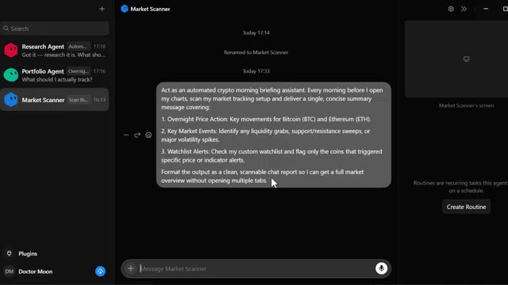
*⏱️ 00:00:07 — Interface d'un assistant virtuel nommé Market Scanner affichant un prompt détaillé pour l'analyse automatisée des cryptomonnaies.*

---

### ⏱️ `[00:00:27 - 00:01:02]` | Segment #02

**🔊 Audio (Transcription Intégrale Mot pour Mot en Français) :**
> et ensuite je vais vous présenter en détail l'équipe de recherche réelle que j'ai construite et qui gère mon propre trading de cryptomonnaies 24 heures sur 24 et 7 jours sur 7 sans que je ne lève le petit doigt. Maintenant, ce n'est pas spécifiquement exclusif aux cryptos, donc même si vous tradez des actions, du forex, des contrats à terme ou n'importe quel marché auquel vous pouvez penser, GrokBot vous aidera certainement et rendra vos recherches de trading beaucoup plus faciles. À la fin de cette vidéo, vous verrez exactement pourquoi je pense que c'est l'un des outils les plus puissants sortis cette année, car il élimine pour ainsi dire toute la friction qui a empêché les traders réguliers, des gens comme vous et moi, de mener à bien leurs

**👁️ Analyse Visuelle d'Écran (gemini-3.5-flash-lite) :**
**Interface & Outils** : Interface de l'application Grok Bot / Market Scanner avec panneaux de configuration et marketplace de plugins.

**Contenu textuel & Code** : Instructions textuelles de configuration pour un scanner technique automatisé (Market Scanner) avec routines programmées (Intraday TA scanner, Morning market scan) et liste de plugins disponibles (Intercom, Amplitude, Apify, Antimetal, Astronomer, Mobbin).

**Action / Démonstration** : Navigation dans l'interface de l'agent de trading, configuration des routines de scan de marché automatisé et exploration de la marketplace de plugins.

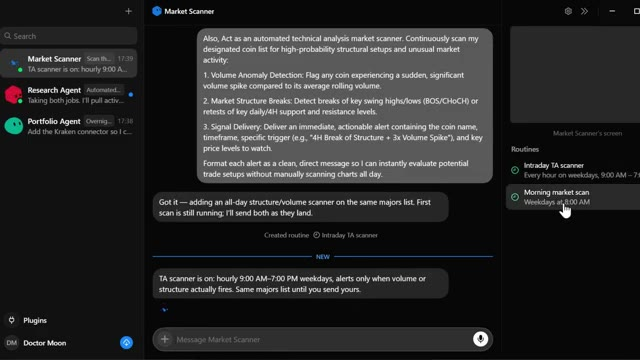
*⏱️ 00:00:35 — Interface d'un assistant de trading automatisé ("Market Scanner") affichant des prompts de configuration pour la détection d'anomalies de volume et de structures de marché.*

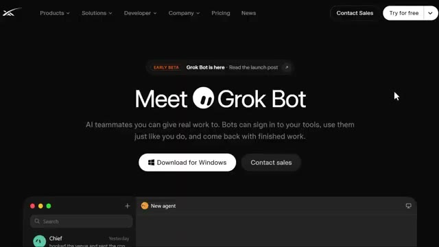
*⏱️ 00:00:44 — Page de présentation officielle du logiciel "Grok Bot" illustrant l'utilisation d'agents IA autonomes pour les tâches de trading et de gestion.*

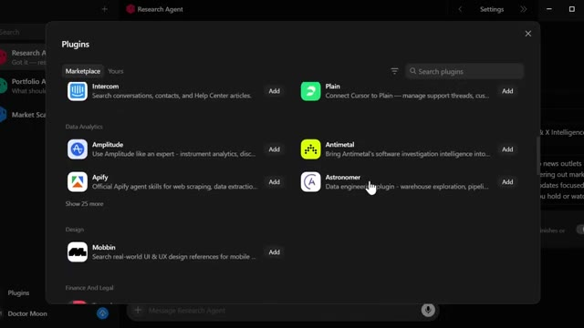
*⏱️ 00:00:53 — Fenêtre de gestion des plugins et intégrations tierces pour l'agent de recherche ("Research Agent") sur la plateforme.*

---

### ⏱️ `[00:01:02 - 00:01:34]` | Segment #03

**🔊 Audio (Transcription Intégrale Mot pour Mot en Français) :**
> propre installation de recherche toujours active. Aucun codage, aucune expérience en développement requise. Alors, sans plus attendre, plongeons-nous dedans. Maintenant, avant d'aborder le bot lui-même, parlons de l'origine de tout cela. Parce que beaucoup d'entre vous connaissent le nom de Grok, mais ne connaissent pas vraiment son histoire. Grok a été créé par xAI, qu'Elon Musk a fondé en 2023 avec essentiellement un seul objectif : construire une IA capable de rivaliser avec OpenAI et de véritablement comprendre le monde, et pas seulement de répondre à des questions. La première version, Grok 1, est sortie en novembre 2023 et a été intégrée

**👁️ Analyse Visuelle d'Écran (gemini-3.5-flash-lite) :**
**Interface & Outils** : Navigateur web affichant une page d'actualités et le site officiel de xAI.

**Contenu textuel & Code** : Texte de présentation de xAI sur Grok (« Why we are building Grok », assistant de recherche et autonomisation).

**Action / Démonstration** : Navigation et défilement sur la page web présentant l'origine et les objectifs de Grok.

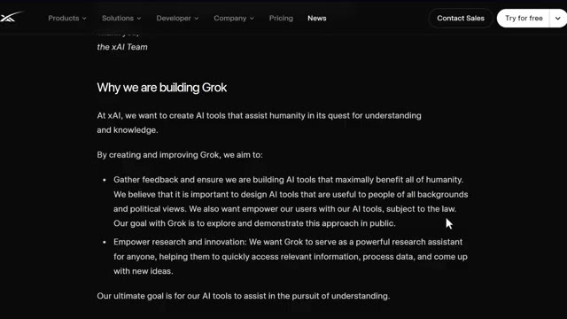
*⏱️ 00:01:26 — Page web officielle de xAI expliquant les motivations derrière la création de l'intelligence artificielle Grok et ses objectifs d'assistance à la recherche.*

---

### ⏱️ `[00:01:34 - 00:01:56]` | Segment #04

**🔊 Audio (Transcription Intégrale Mot pour Mot en Français) :**
> directement dans X. Donc, si vous aviez X Premium, vous y aviez déjà accès sans même vous rendre compte de ce que vous utilisiez. À partir de là, ça a évolué vite. Grok 2, puis Grok 3, puis Grok 4, chacun comblant l'écart avec GPT et Claude. Et honnêtement, dès Grok 3, les gens ont arrêté de l'appeler l'IA de Twitter et ont commencé à le prendre au sérieux en tant que véritable modèle de pointe.

**👁️ Analyse Visuelle d'Écran (gemini-3.5-flash-lite) :**
**Interface & Outils** : Interface de la plateforme X (Twitter) et site web d'information xAI / Grok.

**Contenu textuel & Code** : Menus de navigation X (Home, Explore, Notifications, Grok, Premium) et texte de présentation de Grok 4 (modèle d'IA, intégration de recherche en temps réel, abonnements SuperGrok et Premium+).

**Action / Démonstration** : Navigation sur l'interface de l'outil Grok intégré à X et consultation de la page d'actualités sur le lancement de Grok 4.

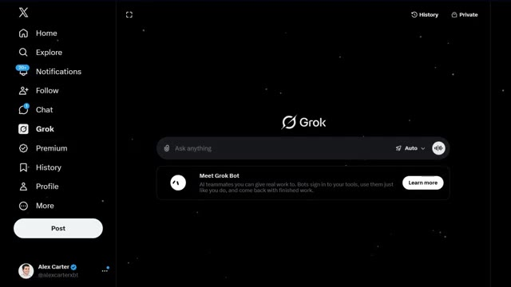
*⏱️ 00:01:39 — Interface de l'application X affichant l'onglet Grok avec la barre de recherche 'Ask anything' et la fonctionnalité 'Meet Grok Bot'.*

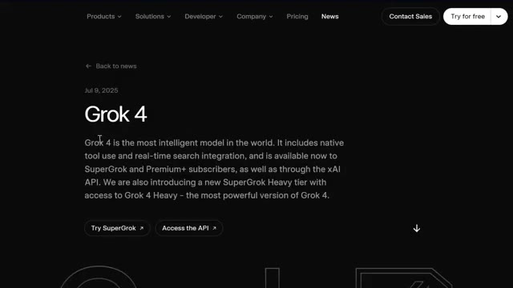
*⏱️ 00:01:45 — Page web d'annonce officielle de xAI présentant le modèle 'Grok 4' avec ses caractéristiques et options d'abonnement.*

---

### ⏱️ `[00:01:56 - 00:02:14]` | Segment #05

**🔊 Audio (Transcription Intégrale Mot pour Mot en Français) :**
> Et maintenant, plus récemment encore, ils ont sorti Grok 4.6, dont je parlerai plus tard parce que ça compte vraiment pour la tarification. Mais voici la partie que la plupart des gens ratent. Grok a cessé d'être juste un chatbot il y a un moment déjà. xAI a pris ce même modèle et a construit un framework d'agents autour. C'est de ça qu'on est vraiment là pour parler aujourd'hui.

**👁️ Analyse Visuelle d'Écran (gemini-3.5-flash-lite) :**
**Interface & Outils** : Navigateur web affichant le site de xAI/X et l'interface utilisateur de Grok.

**Contenu textuel & Code** : Texte d'annonce officiel de "Grok 4.6" et interface de discussion de Grok sur la plateforme X.

**Action / Démonstration** : Présentation des nouveautés et de l'évolution de Grok vers de nouveaux cas d'usage par xAI.

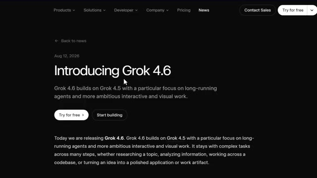
*⏱️ 00:02:01 — Page web officielle présentant la sortie de Grok 4.6 avec des détails sur ses nouvelles fonctionnalités.*

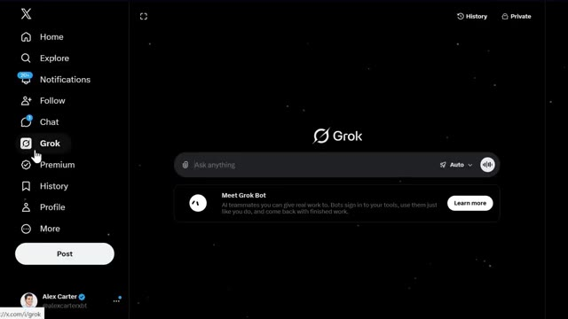
*⏱️ 00:02:05 — Interface de la plateforme X (anciennement Twitter) affichant la section Grok et l'option "Meet Grok Bot".*

---

### ⏱️ `[00:02:15 - 00:02:33]` | Segment #06

**🔊 Audio (Transcription Intégrale Mot pour Mot en Français) :**
> Voici donc GrokBot, et honnêtement, l'appeler simplement un outil d'intelligence artificielle ne lui rend même pas justice. C'est fondamentalement une équipe complète d'agents qui ne pointent jamais, n'ont jamais besoin de rappels, et continuent simplement de bosser en arrière-plan 24 heures sur 24, 7 jours sur 7. Vous n'avez pas besoin d'un serveur privé virtuel qui tourne en continu. Vous n'avez pas besoin de configurer des fichiers mémoire pendant des heures.

**👁️ Analyse Visuelle d'Écran (gemini-3.5-flash-lite) :**
**Interface & Outils** : Interface web de gestion d'agents IA (Grok Bot).

**Contenu textuel & Code** : Liste d'agents spécialisés (Inbox Manager, Account Manager, Talent Scout, Expense Manager) et descriptions textuelles de leurs tâches automatisées fonctionnant 24/7.

**Action / Démonstration** : Navigation et présentation visuelle de l'écosystème d'agents multiples en arrière-plan.

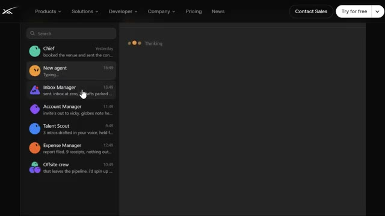
*⏱️ 00:02:19 — Interface d'une application de gestion avec plusieurs agents virtuels listés (Chief, New agent, Inbox Manager, etc.) et un panneau de réflexion 'Thinking'.*

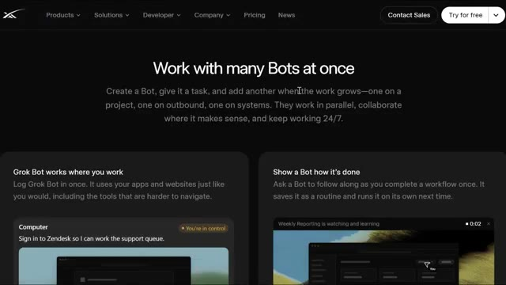
*⏱️ 00:02:29 — Page de présentation du site web illustrant les fonctionnalités de multi-bots avec le titre 'Work with many Bots at once'.*

---

### ⏱️ `[00:02:34 - 00:02:57]` | Segment #07

**🔊 Audio (Transcription Intégrale Mot pour Mot en Français) :**
> Vous le téléchargez, vous vous connectez à un compte, et vous avez déjà une équipe d'agents prêts à travailler. Si vous vous êtes déjà senti dépassé en essayant de configurer un système d'IA toujours actif pour votre trading, vous n'êtes pas seul. Et ce n'est pas votre faute. La plupart de ces outils ont bien trop de frictions. Il peut se connecter à pratiquement n'importe quel modèle, Grok, Opus, GPT, Gemini, tout ce que vous voulez faire tourner en arrière-plan.

**👁️ Analyse Visuelle d'Écran (gemini-3.5-flash-lite) :**
**Interface & Outils** : Interface logicielle de configuration, plateforme d'échange WEEX, et documentation de dépôt de code.

**Contenu textuel & Code** : Plugins Marketplace, paramètres de création d'API (Spot, Futures, adresse IP), et fonctions de contrôle de graphiques (chart_set_symbol, chart_set_timeframe).

**Action / Démonstration** : Navigation dans les plugins, configuration des clés d'accès API pour un bot de trading, et consultation de la documentation technique.

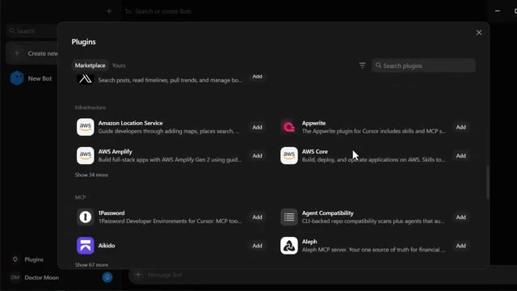
*⏱️ 00:02:39 — Fenêtre de plugins montrant l'intégration de divers services et outils MCP.*

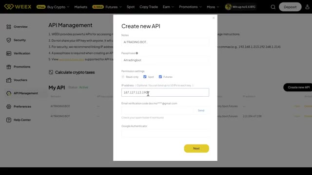
*⏱️ 00:02:45 — Interface de gestion d'API de la plateforme WEEX avec la configuration de création d'une nouvelle clé API.*

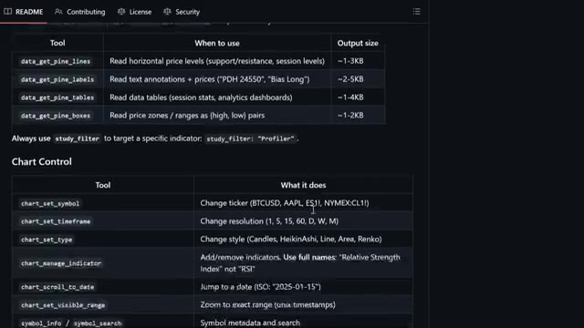
*⏱️ 00:02:51 — Documentation technique listant les outils de contrôle de graphiques et leurs fonctions associées.*

---

### ⏱️ `[00:02:57 - 00:03:17]` | Segment #08

**🔊 Audio (Transcription Intégrale Mot pour Mot en Français) :**
> Et comme il a son propre ordinateur, il peut parcourir des graphiques, extraire des données, exécuter des scripts et continuer à travailler pendant que vous dormez littéralement ou que vous regardez une autre vidéo sur cette chaîne. Maintenant, la plupart d'entre vous paient déjà pour ChatGPT, Gemini ou Claude. Soyons donc réalistes sur la raison pour laquelle c'est différent. ChatGPT reste probablement le meilleur assistant conversationnel polyvalent du marché.

**👁️ Analyse Visuelle d'Écran (gemini-3.5-flash-lite) :**
**Interface & Outils** : TradingView, Pine Editor, interface de chat d'un agent de trading automatisé, et interface Claude AI.

**Contenu textuel & Code** : Code source en Pine Script (stratégie MACD, conditions d'alerte, signaux long/short) et instructions textuelles pour un agent de market scanner (détection de volume, structures de marché BOS/ChoCh).

**Action / Démonstration** : Présentation d'un script de trading automatisé et configuration d'un agent d'analyse technique de marché.

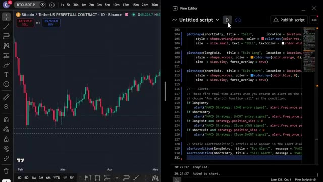
*⏱️ 00:03:02 — Un graphique TradingView affichant l'évolution du Bitcoin sur une journée (1D) avec, côte à côte, l'éditeur de code Pine Editor montrant un script de stratégie MACD.*

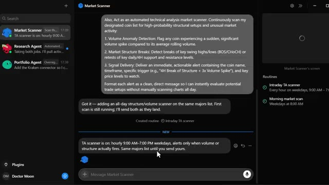
*⏱️ 00:03:07 — Une interface de type assistant conversationnel ("Market Scanner") configurée pour l'analyse technique automatisée et la détection d'anomalies de volume.*

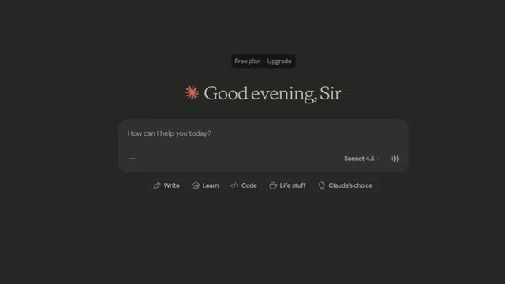
*⏱️ 00:03:12 — L'interface d'accueil sombre d'un assistant IA (Claude) avec le message "Good evening, Sir" et une barre de saisie pour poser des questions ou exécuter du code.*

---

### ⏱️ `[00:03:18 - 00:03:37]` | Segment #09

**🔊 Audio (Transcription Intégrale Mot pour Mot en Français) :**
> Parfait pour des questions rapides, expliquer une installation, rédiger quelque chose rapidement. Mais dès que vous voulez qu'il vérifie des prix pendant la nuit, qu'il analyse votre liste de surveillance pendant que vous dormez, tout s'effondre. Parce que ce n'est pas un agent, c'est une conversation. Il répond quand vous demandez. Il ne travaille pas quand vous ne le faites pas. Gemini s'en sort vraiment très bien pour tout ce qui est basé sur la recherche.

**👁️ Analyse Visuelle d'Écran (gemini-3.5-flash-lite) :**
**Interface & Outils** : TradingView, Binance (graphique de prix), ChatGPT (interface web).

**Contenu textuel & Code** : Graphique de prix Bitcoin (BTC/USDT) en timeframe court avec volumes et oscillateur MACD ; interface ChatGPT présentant une analyse textuelle et des estimations de prix (Range : $90K - $180K, Base case : $120K - $140K).

**Action / Démonstration** : Visualisation d'un graphique technique et d'une interface d'intelligence artificielle pour illustrer la discussion sur les capacités d'analyse de marché.

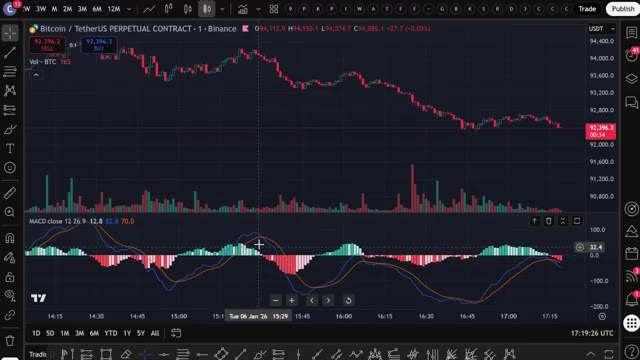
*⏱️ 00:03:27 — Graphique TradingView en chandelier japonais du contrat perpétuel Bitcoin / TetherUS sur Binance, avec indicateur MACD et volumes.*

---

### ⏱️ `[00:03:37 - 00:03:56]` | Segment #10

**🔊 Audio (Transcription Intégrale Mot pour Mot en Français) :**
> Récupération de données en direct, recoupement d'actualités. Mais même problème. Pas d'ordinateur persistant, pas de mémoire qui fait avancer une tâche de manière autonome. Dès que vous fermez l'onglet, le travail s'arrête. Claude, en particulier Opus, est généralement le modèle de raisonnement le plus fort des trois, à mon avis. Et voici le point.

**👁️ Analyse Visuelle d'Écran (gemini-3.5-flash-lite) :**
**Interface & Outils** : Navigateur web affichant les plateformes X (Twitter), Google Gemini et le site d'Anthropic (Claude Opus).

**Contenu textuel & Code** : Page de présentation du modèle d'IA Claude Opus par Anthropic avec description de ses capacités de raisonnement hybride et de fenêtre de contexte.

**Action / Démonstration** : Navigation web et présentation visuelle des interfaces et annonces de modèles d'IA par le présentateur.

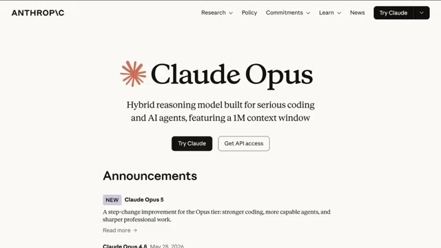
*⏱️ 00:03:52 — Capture d'écran du site officiel d'Anthropic présentant la page d'annonce et de documentation pour le modèle Claude Opus.*

---

### ⏱️ `[00:03:57 - 00:04:17]` | Segment #11

**🔊 Audio (Transcription Intégrale Mot pour Mot en Français) :**
> GrokBot peut en fait faire tourner Opus en dessous. Ce n'est donc pas vraiment GrokBot contre Claude. C'est l'intelligence de Claude, moins les jours de configuration manuelle qu'il faut normalement pour connecter soi-même l'utilisation de l'ordinateur, les fichiers de mémoire et les connexions MCP. Vous pensez peut-être que votre configuration actuelle d'IA vous offre déjà une analyse solide.

**👁️ Analyse Visuelle d'Écran (gemini-3.5-flash-lite) :**
**Interface & Outils** : Interface du réseau social X, terminal de commande SSH/Linux, et documentation de dépôt GitHub.

**Contenu textuel & Code** : Publication sur X avec logs de curseur, lignes de commandes Linux (`adduser`, `ufw enable`), et tableau de référence d'outils MCP (`chart_get_state`, `quote_get`).

**Action / Démonstration** : Navigation sur les réseaux sociaux, configuration système d'un serveur distant, et consultation de documentation technique d'outils MCP.

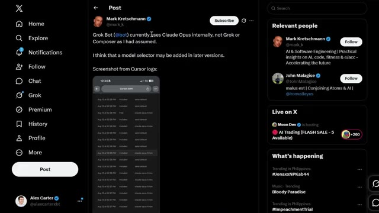
*⏱️ 00:04:02 — Capture d'écran d'un tweet sur X montrant une discussion sur l'utilisation de Claude Opus par Grok Bot.*

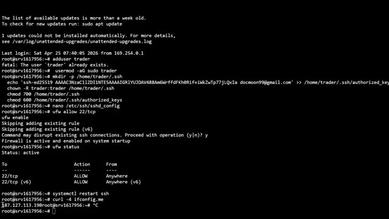
*⏱️ 00:04:07 — Terminal de commande Linux affichant des instructions de configuration de serveur et de pare-feu (SSH, ufw).*

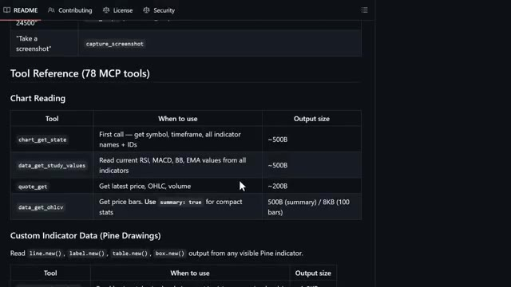
*⏱️ 00:04:12 — Documentation d'un projet GitHub listant des outils de référence MCP (Model Context Protocol) pour la lecture de graphiques.*

---

### ⏱️ `[00:04:17 - 00:04:37]` | Segment #12

**🔊 Audio (Transcription Intégrale Mot pour Mot en Français) :**
> Pourquoi est-ce que j'ai besoin d'un cadre d'agent en plus ? Mais les données montrent quelque chose de différent. Un modèle de conversation répond quand vous demandez. Un cadre d'agent comme GrokBot fonctionne que vous demandiez ou non. Et le dernier élément, c'est le coût et la vitesse. L'équipe d'Elon vient de sortir Grok 4.6, qui est moins cher qu'Opus, mais qui atteint bon nombre des mêmes capacités.

**👁️ Analyse Visuelle d'Écran (gemini-3.5-flash-lite) :**
**Interface & Outils** : Interface web d'agents conversationnels et tableau de bord de benchmarks de modèles d'IA.

**Contenu textuel & Code** : Liste d'agents IA autonomes et graphique statistique comparant "Table 5 Max" (62), "Grok 4.6" (61), "GPT-5.6 Sol Max" (61) et "Grok 4.5 High" (56).

**Action / Démonstration** : Navigation et sélection d'un agent dans le panneau latéral gauche, puis affichage des performances comparatives des modèles.

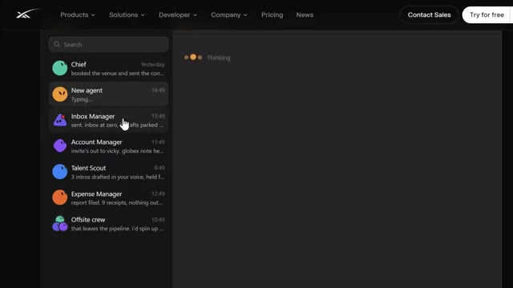
*⏱️ 00:04:22 — Interface d'une application de gestion d'agents IA listant différents assistants virtuels comme "Chief", "New agent", "Inbox Manager", et "Account Manager".*

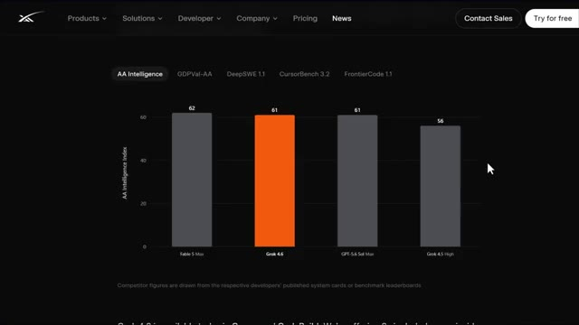
*⏱️ 00:04:32 — Graphique à barres comparatif des performances de différents modèles d'IA sur un indice d'intelligence, mettant en avant Grok 4.6 à 61 points.*

---

### ⏱️ `[00:04:37 - 00:05:09]` | Segment #13

**🔊 Audio (Transcription Intégrale Mot pour Mot en Français) :**
> Donc vous obtenez une intelligence de niveau pionnier sans avoir à faire tourner cinq abonnements en parallèle. C'est vraiment ça le fossé. Ce n'est pas que GrokBot soit plus intelligent que ChatGPT, Gemini ou Claude dans tous les cas. C'est qu'il est toujours actif. C'est du prêt-à-l'emploi et ça ne vous pénalise pas pour le fait de n'être pas un développeur. Bon, entrons maintenant dans le vif de la configuration, car je sais que beaucoup d'entre vous apprennent le mieux en voyant les choses étape par étape, exactement comme je le fais sur ma chaîne de tutoriels. Première étape, allez sur la page d'inscription de GrokBot. Vous pouvez vérifier le lien en bas dans la description. Vous allez

**👁️ Analyse Visuelle d'Écran (gemini-3.5-flash-lite) :**
**Interface & Outils** : Interface de gestion de plugins et page web officielle de Grok Bot.

**Contenu textuel & Code** : Catalogue de plugins (Marketplace) et page d'accueil de présentation d'un agent IA.

**Action / Démonstration** : Navigation dans le store de plugins et présentation de l'application Grok Bot.

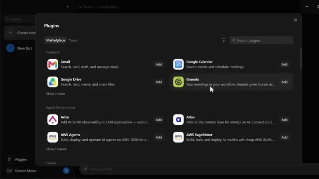
*⏱️ 00:04:45 — Interface montrant la liste des plugins disponibles avec des intégrations comme Gmail, Google Drive et Granola.*

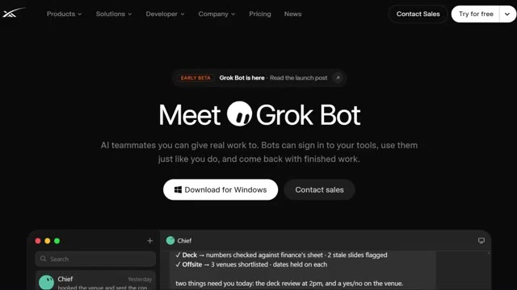
*⏱️ 00:04:53 — Page web de présentation officielle de Grok Bot ("Meet Grok Bot") avec le bouton de téléchargement pour Windows.*

---

### ⏱️ `[00:05:09 - 00:05:41]` | Segment #14

**🔊 Audio (Transcription Intégrale Mot pour Mot en Français) :**
> amené sur cette page où vous pouvez voir que c'est en version bêta anticipée. Vous pouvez voir l'annonce de lancement ici. Lorsque vous faites défiler vers le bas, vous pouvez voir le bouton de téléchargement ici. Maintenant, cela dépend si vous avez un Mac ou Windows, mais pour ceci, nous allons utiliser Windows. Puisque c'est ce que nous utilisons,cliquez dessus et une fenêtre de téléchargement apparaîtra. Suivez simplement l'installation sur votre appareil, attendez quelques minutes, et vous êtes prêts. Une fois que vous ouvrez l'application, une fenêtre de connexion apparaîtra, cliquez dessus, et suivez les instructions. Vous pouvez activer votre essai gratuit ici. Une fois que c'est configuré, vous serez de retour sur le

**👁️ Analyse Visuelle d'Écran (gemini-3.5-flash-lite) :**
**Interface & Outils** : Site web et application de bureau Grok Bot.

**Contenu textuel & Code** : Boutons de téléchargement, interface de chat d'agents IA et options de connexion.

**Action / Démonstration** : Navigation sur le site de téléchargement et sélection d'une option de lancement de l'application.

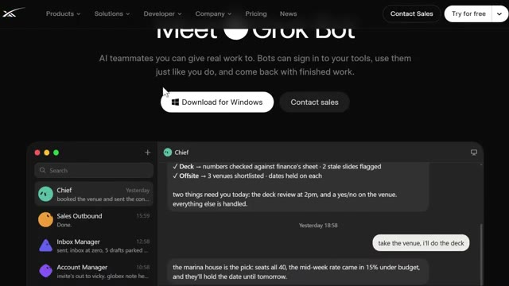
*⏱️ 00:05:17 — Page web de présentation de Grok Bot avec un bouton de téléchargement pour Windows et un aperçu de l'interface de discussion.*

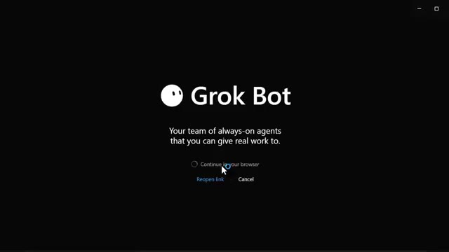
*⏱️ 00:05:33 — Fenêtre d'application affichant le logo Grok Bot avec une option de connexion via le navigateur.*

---

### ⏱️ `[00:05:41 - 00:06:14]` | Segment #15

**🔊 Audio (Transcription Intégrale Mot pour Mot en Français) :**
> application de bureau. Deuxième étape, une fois que vous arrivez sur votre tableau de bord, c'est votre centre de contrôle. C'est ici que vous allez lancer vos agents. Troisième étape, cliquez sur nouveau bot ou cliquez sur l'icône plus et attribuez-lui un rôle. Pour le trading de crypto, voici exactement ce que je configurerais. Un agent scanner de marché. Chaque matin, il vérifie votre liste de surveillance, signale toute pièce qui sort de sa plage normale et vous envoie un résumé avant même que vous n'ouvriez vos graphiques. Un agent de portefeuille. Avec ce bot, vous pouvez le connecter à votre échange, qu'il s'agisse de votre tableur avec des appels d'API en direct ou d'un direct

**👁️ Analyse Visuelle d'Écran (gemini-3.5-flash-lite) :**
**Interface & Outils** : Application de bureau (Interface de gestion de bots)

**Contenu textuel & Code** : Panneau latéral gauche avec la liste des bots (recherche, 'New Bot', Plugins, Doctor Moon) et une zone de saisie centrale 'Message New Bot'.

**Action / Démonstration** : Navigation et sélection de 'New Bot' dans l'interface de l'application pour configurer un agent.

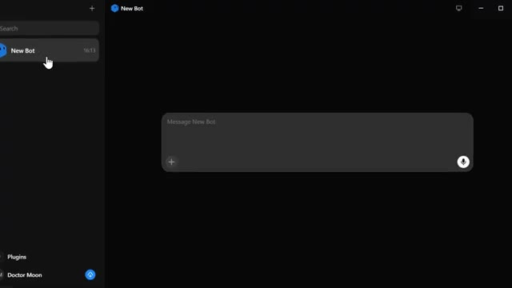
*⏱️ 00:05:49 — Interface de l'application de bureau montrant le tableau de bord avec un curseur de souris sur 'New Bot' dans le panneau latéral gauche et une zone de message au centre.*

---

### ⏱️ `[00:06:14 - 00:06:48]` | Segment #16

**🔊 Audio (Transcription Intégrale Mot pour Mot en Français) :**
> lecture de la connexion à votre compte. Et chaque matin, il vous donne un récapitulatif de la nuit. Qu'est-ce qui a bougé ? Qu'est-ce qui est au calendrier aujourd'hui ? Et si un élément de vos positions nécessite de l'attention. Un agent de recherche, où vous pouvez le configurer pour analyser les actualités crypto et X toutes les quelques heures et compiler uniquement ce qui est réellement pertinent pour les pièces que vous détenez ou surveillez. Quatrième étape, sous l'onglet plugins, vous pouvez le connecter à Google Sheets, Gmail, Slack et d'autres outils. De la même manière que vous connectez un MCP dans Claude. C'est là que ça devient puissant pour le trading en particulier, car vous pouvez littéralement

**👁️ Analyse Visuelle d'Écran (gemini-3.5-flash-lite) :**
**Interface & Outils** : Interface de chat d'agents conversationnels (type application de productivité / trading assistant)

**Contenu textuel & Code** : Panneau de configuration du bot "Portfolio Agent" avec titre "Overnight Portfolio & Position Recap" et description de connexion aux comptes d'échange, ainsi qu'une liste de plugins (Intercom, Plain, Amplitude, Antimetal, Apify, Astronomer, Mobbin).

**Action / Démonstration** : Navigation dans les paramètres de configuration du bot de portfolio et affichage du catalogue de plugins disponibles pour les agents.

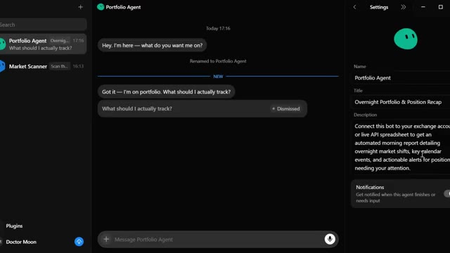
*⏱️ 00:06:23 — Interface d'un agent conversationnel montrant les paramètres du "Portfolio Agent" avec sa description pour le récapitulatif nocturne.*

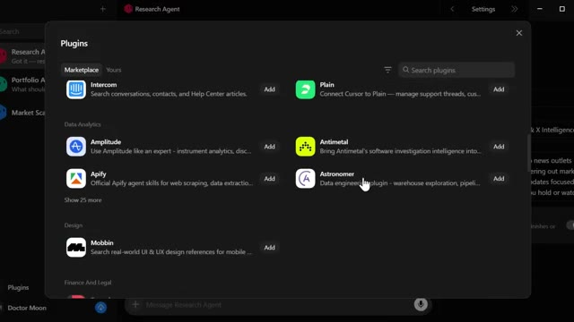
*⏱️ 00:06:40 — Fenêtre de marketplace de plugins d'agents conversationnels listant différents outils d'analyse de données et d'intégration.*

---

### ⏱️ `[00:06:48 - 00:07:11]` | Segment #17

**🔊 Audio (Transcription Intégrale Mot pour Mot en Français) :**
> donnez-lui un accès en lecture à vos données d'échange et faites-le vous faire un rapport comme le ferait un analyste. Note importante, et je le dis à chaque fois que je parle d'automatisation et d'argent, lorsqu'il s'agit de l'exécution réelle des transactions, soyez beaucoup plus prudent. Les rapports et l'analyse, aucun problème. Le laisser placer de vrais trades en votre nom est une autre discussion et quelque chose que vous devez examiner attentivement avant de le connecter.

**👁️ Analyse Visuelle d'Écran (gemini-3.5-flash-lite) :**
**Interface & Outils** : Application de type agent d'IA ou chatbot avec panneau de configuration (Market Scanner).

**Contenu textuel & Code** : Description de l'agent : "Every morning, this automated system scans your personal watchlist, flags any coin experiencing unusual price movement beyond its typical range, and delivers a concise summary directly to you before you even open your charts."

**Action / Démonstration** : Configuration et présentation des paramètres de l'agent de scan automatisé des marchés.

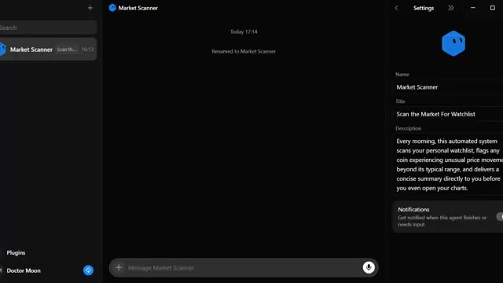
*⏱️ 00:06:54 — Interface d'un assistant de scan de marché automatisé configuré pour analyser la liste de surveillance.*

---

### ⏱️ `[00:07:12 - 00:07:35]` | Segment #18

**🔊 Audio (Transcription Intégrale Mot pour Mot en Français) :**
> Maintenant, laissez-moi vous montrer exactement comment j'utiliserais cela pour le trading et l'investissement, parce que c'est là que ça devient réellement utile et pas seulement un gadget sympa. 1. Récapitulatif du marché nocturne. Au lieu de vous réveiller et de faire défiler 15 onglets, vous ouvrez un seul chat et il vous dit ce que le Bitcoin et l'Ethereum ont fait pendant la nuit, s'il y a eu des chasses à la liquidité, et si les pièces de votre liste de surveillance ont déclenché des alertes.

**👁️ Analyse Visuelle d'Écran (gemini-3.5-flash-lite) :**
**Interface & Outils** : Application de type chat IA / assistant virtuel (avec barre latérale listant différents agents : Research Agent, Portfolio Agent, Market Scanner).

**Contenu textuel & Code** : Prompt utilisateur affiché à l'écran demandant d'agir comme un assistant de briefing matinal crypto pour scanner l'action des prix nocturne (Bitcoin/Ethereum), les événements clés du marché et les alertes de la watchlist, afin d'éviter d'ouvrir de multiples onglets.

**Action / Démonstration** : Présentation de la configuration d'un agent IA automatisé pour la génération d'un récapitulatif du marché nocturne.

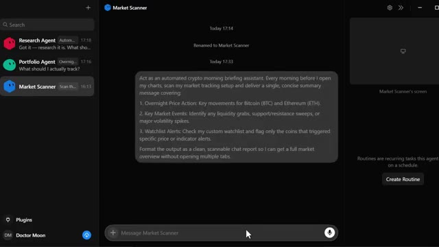
*⏱️ 00:07:18 — Interface d'une application d'intelligence artificielle montrant un agent nommé 'Market Scanner' configuré avec un prompt détaillé pour analyser automatiquement le marché crypto chaque matin.*

---

### ⏱️ `[00:07:36 - 00:07:57]` | Segment #19

**🔊 Audio (Transcription Intégrale Mot pour Mot en Français) :**
> 2. Instructions de rééquilibrage de portefeuille. Si vous êtes comme beaucoup de traders qui oublient de rééquilibrer, vous pouvez littéralement dire : Signalez-moi si une position s'écarte de plus de 10 % de l'allocation cible, et il vous dira exactement quand et de combien. Trois, la recherche de valeurs aberrantes. De la même manière que j'utilise ce concept sur ma chaîne d'analyse technique.

**👁️ Analyse Visuelle d'Écran (gemini-3.5-flash-lite) :**
**Interface & Outils** : Application de type chat avec agent IA pour la gestion et le rééquilibrage de portefeuille.

**Contenu textuel & Code** : Instructions détaillées de l'utilisateur pour le suivi des allocations, l'identification des dérives (>10%) et les détails de rééquilibrage.

**Action / Démonstration** : Configuration et instruction d'un agent IA pour automatiser le suivi et l'alerte de rééquilibrage du portefeuille.

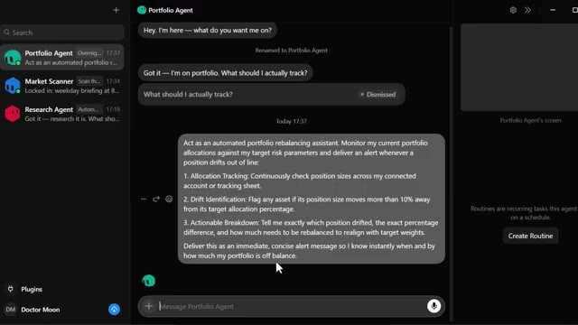
*⏱️ 00:07:41 — Interface d'un assistant virtuel de portefeuille montrant un prompt demandant de surveiller les allocations et de signaler les écarts de plus de 10 %.*

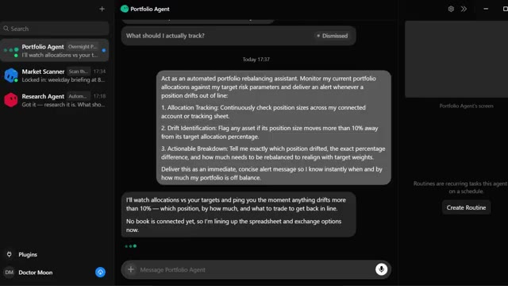
*⏱️ 00:07:52 — Suite de la conversation avec l'assistant de portefeuille qui confirme la prise en compte des instructions de rééquilibrage.*

---

### ⏱️ `[00:07:58 - 00:08:16]` | Segment #20

**🔊 Audio (Transcription Intégrale Mot pour Mot en Français) :**
> Tu peux le faire scanner à la recherche de pièces montrant un volume inhabituel ou brisant une structure clé. Ainsi, tu ne vérifies pas manuellement les graphiques toute la journée. Quatrièmement, la recherche de parrainages et de projets. Si tu gères une page ou une chaîne crypto comme je le fais, tu peux littéralement lui faire scanner quels projets dépensent le plus en publicité en ce moment.

**👁️ Analyse Visuelle d'Écran (gemini-3.5-flash-lite) :**
**Interface & Outils** : Interface de type messagerie/agent IA (Market Scanner et Research Agent) avec panneaux de configuration des routines.

**Contenu textuel & Code** : Prompts de configuration pour l'analyse technique automatisée et liste de prospects publicitaires (Polymarket, Toobit, MEXC, Kraken, Injective).

**Action / Démonstration** : Démonstration de l'automatisation des tâches de scan de marché et de recherche de partenariats commerciaux.

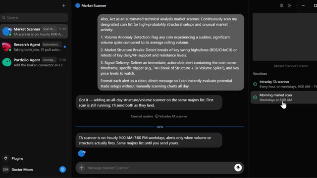
*⏱️ 00:08:02 — Interface d'un agent conversationnel configuré en tant que "Market Scanner" pour détecter les volumes inhabituels et ruptures de structure.*

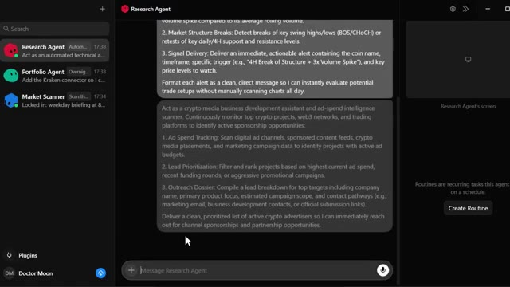
*⏱️ 00:08:07 — Interface de l'agent "Research Agent" programmé pour analyser et identifier les opportunités de parrainage et de publicité crypto.*

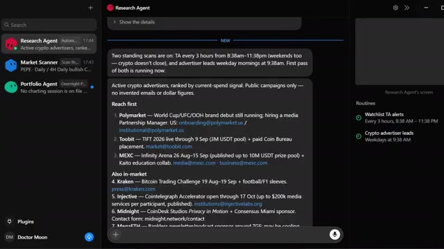
*⏱️ 00:08:12 — Liste générée par le "Research Agent" montrant les annonceurs crypto actifs classés par signal de dépenses, avec emails de contact.*

---

### ⏱️ `[00:08:17 - 00:08:52]` | Segment #21

**🔊 Audio (Transcription Intégrale Mot pour Mot en Français) :**
> Comme ça, vous savez qui contacter. Cinq, formation à l'apprentissage et aux flux de travail. Vous pouvez vous enregistrer en train d'effectuer votre propre processus d'analyse technique, et il apprendra réellement à en répliquer des parties pour vous avec le temps. Mais voici le point important. GrokBot n'est pas seulement conçu pour le trading de crypto. Si vous avez d'autres tâches pour gérer votre entreprise ou votre vie, GrokBot peut aussi s'en charger. Vous pouvez le configurer pour la vente, la prospection, le recrutement de talents, la gestion des médias payants, la gestion des dépenses, le suivi des performances des produits, la reproduction de bugs, la surveillance de la santé des comptes, et même pour un rôle complet de chef de cabinet, GrokBot peut vraiment

**👁️ Analyse Visuelle d'Écran (gemini-3.5-flash-lite) :**
**Interface & Outils** : Application de gestion de portefeuille et site web officiel de présentation des bots (Grok Bot).

**Contenu textuel & Code** : Texte de prompt détaillant l'extraction de processus d'analyse technique, la codification de règles et la réplication de stratégies ; descriptions des fonctionnalités des bots.

**Action / Démonstration** : Navigation sur l'interface du bot et présentation des capacités d'apprentissage des workflows et de gestion automatisée.

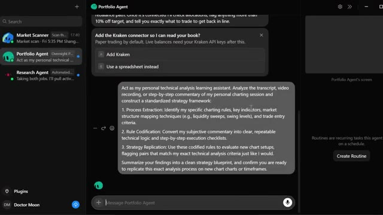
*⏱️ 00:08:25 — Interface de l'assistant virtuel Portfolio Agent montrant un prompt textuel détaillé sur l'analyse technique et l'extraction de processus.*

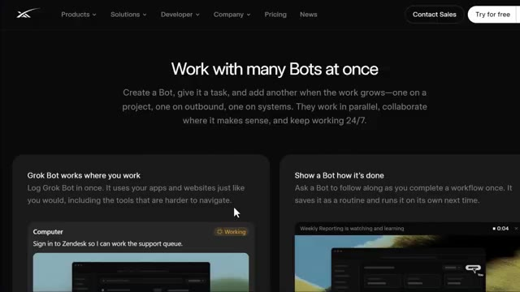
*⏱️ 00:08:34 — Page Web présentant les fonctionnalités de "Grok Bot", avec les sections "Grok Bot works where you work" et "Show a Bot how it's done".*

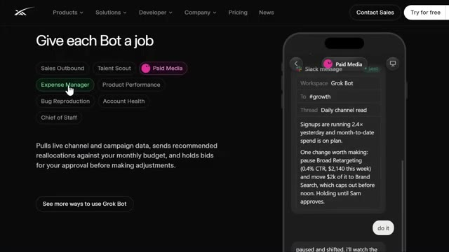
*⏱️ 00:08:43 — Page Web montrant l'attribution de rôles aux bots ("Give each Bot a job") avec un aperçu d'une interface mobile sur Slack.*

---

### ⏱️ `[00:08:52 - 00:09:26]` | Segment #22

**🔊 Audio (Transcription Intégrale Mot pour Mot en Français) :**
> tout faire. Les cas d'usage de la crypto sont juste là où je pointe en ce moment parce que c'est ce qui est pertinent pour vous et moi. Très bien, parlons des prix parce que je sais que c'est là que beaucoup d'entre vous vont avoir des avis. Cursor Ultra coûte 200 dollars par mois, facturé mensuellement. Cela inclut le propre ordinateur de GrokBot. Il se connecte à vos outils, exécute des routines selon un calendrier, fonctionne partout sur ordinateur, mobile, et plus encore, et vous donne des limites étendues sur les jetons AE. Supergirl Heavy coûte 300 dollars par mois, facturé mensuellement, et c'est tout ce qu'il y a dans Supergirl plus l'utilisation la plus élevée à la vitesse la plus rapide,

**👁️ Analyse Visuelle d'Écran (gemini-3.5-flash-lite) :**
**Interface & Outils** : Site web de tarification et de présentation des abonnements (interface SaaS).

**Contenu textuel & Code** : Tarifs des abonnements : Cursor Ultra (200 $/mois), SuperGrok Heavy (300 $/mois) et Cursor Premium Teams (120 $/siège/mois), avec la liste des fonctionnalités incluses pour chaque offre.

**Action / Démonstration** : Navigation sur la page des prix et présentation des différentes offres d'abonnement pour l'outil IA.

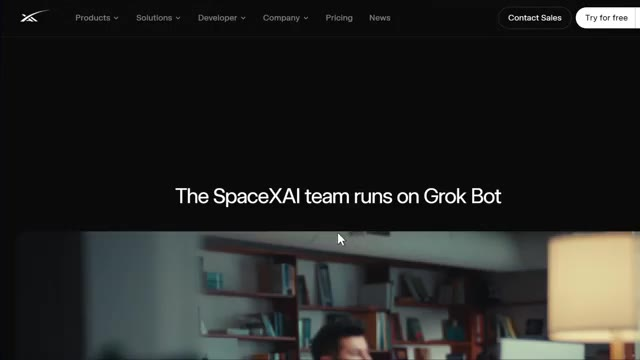
*⏱️ 00:09:01 — Page web affichant le titre « The SpaceXAI team runs on Grok Bot » avec le menu de navigation supérieur et une section vidéo.*

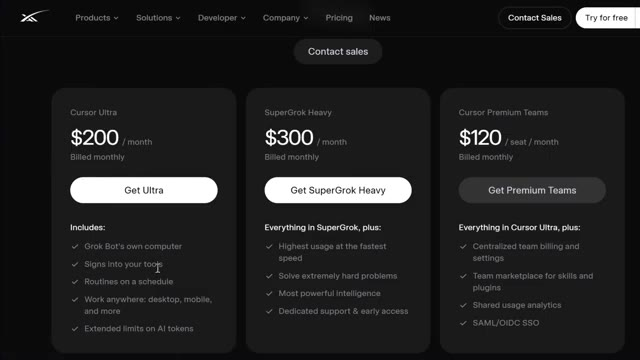
*⏱️ 00:09:09 — Page de tarification présentant trois offres : Cursor Ultra à 200 $/mois, SuperGrok Heavy à 300 $/mois et Cursor Premium Teams à 120 $/siège/mois.*

---

### ⏱️ `[00:09:27 - 00:09:51]` | Segment #23

**🔊 Audio (Transcription Intégrale Mot pour Mot en Français) :**
> la capacité de résoudre des problèmes extrêmement difficiles, l'intelligence la plus puissante, et un support dédié en accès anticipé. Cursor Premium Teams coûte 120 dollars par utilisateur et par mois, facturé mensuellement, et cela inclut tout ce qui est dans Cursor Ultra plus la création d'équipes et les paramètres centralisés, un marché d'équipe pour les compétences et les modules d'extension, des analyses d'utilisation partagées, et le protocole SAML ou O-I-D-C-S-S-O.

**👁️ Analyse Visuelle d'Écran (gemini-3.5-flash-lite) :**
**Interface & Outils** : Page web de tarification (Pricing) avec interface sombre et cartes de forfaits.

**Contenu textuel & Code** : Tarifs affichés ($200/month, $300/month, $120/seat/month) et listes des fonctionnalités incluses pour chaque offre.

**Action / Démonstration** : Présentation et comparaison des différentes options d'abonnement et de leurs tarifs respectifs.

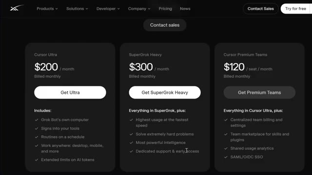
*⏱️ 00:09:33 — Capture d'écran montrant la page de tarification avec différentes offres, incluant Cursor Ultra à 200 $ par mois, SuperGrok Heavy à 300 $ par mois et Cursor Premium Teams à 120 $ par utilisateur et par mois.*

---

### ⏱️ `[00:09:52 - 00:10:15]` | Segment #24

**🔊 Audio (Transcription Intégrale Mot pour Mot en Français) :**
> Maintenant, comparez la tarification à d'autres modèles comme ChatGPT, Google Gemini et Claude d'Anthropic. ChatGPT Plus coûte 20 dollars par mois, ce qui vous donne l'expérience standard à laquelle la plupart des gens sont habitués. Mais si vous voulez leur modèle de raisonnement haut de gamme, ChatGPT Pro coûte 200 dollars par mois. Donc, rien que là, vous payez la même chose que pour le niveau supérieur de GrokBot, mais vous obtenez toujours seulement une conversation, et non un agent toujours actif doté de son propre ordinateur.

**👁️ Analyse Visuelle d'Écran (gemini-3.5-flash-lite) :**
**Interface & Outils** : Interface web de tarification ChatGPT et articles ou blogs comparatifs.

**Contenu textuel & Code** : Grille tarifaire détaillée affichant les prix par mois (0$, 8$, 20$, 100$, 200$) et les fonctionnalités associées à chaque formule (limites d'utilisation, modèles avancés).

**Action / Démonstration** : Présentation visuelle et comparaison des différentes options de tarification des modèles d'intelligence artificielle à l'écran.

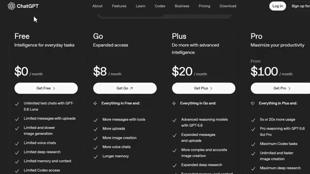
*⏱️ 00:09:58 — Page de tarification de ChatGPT montrant les différentes offres : Free (0$), Go (8$), Plus (20$) et Pro (100$).*

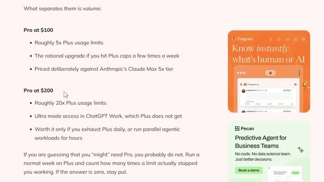
*⏱️ 00:10:09 — Texte explicatif sur les volumes d'utilisation des abonnements Pro à 100$ et 200$, avec des encarts publicitaires sur le côté.*

---

### ⏱️ `[00:10:16 - 00:10:51]` | Segment #25

**🔊 Audio (Transcription Intégrale Mot pour Mot en Français) :**
> Gemini est similaire. Google AI Pro, qui s'appelait autrefois Gemini Advance, coûte 19,99 $ par mois pour la formule standard. Mais si vous voulez leur formule ultra dotée des capacités maximales, cela passe à 99,99 $ par mois. Et il y a une formule encore plus élevée à 199,99 $ par mois. Encore une fois, c'est une vraie somme d'argent pour un modèle qui ne fonctionne toujours que lorsque vous le sollicitez activement. Et Claude max cinq fois coûte 100 $ par mois et max 20 fois, leur formule la plus élevée est à 200 $ par mois. Vous payez donc le prix de GrokBot pour Claude

**👁️ Analyse Visuelle d'Écran (gemini-3.5-flash-lite) :**
**Interface & Outils** : Navigateur web affichant les pages de tarification officielles de Gemini et Claude.

**Contenu textuel & Code** : Tableaux comparatifs des prix et fonctionnalités des abonnements d'IA (tarifs mensuels en dollars, limites d'utilisation, fonctionnalités avancées).

**Action / Démonstration** : Présentation comparative des grilles tarifaires des différentes offres d'intelligence artificielle.

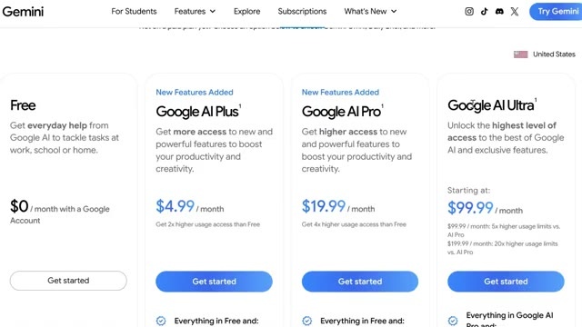
*⏱️ 00:10:25 — Page de tarification de Gemini affichant les différentes formules : Free ($0), Google AI Plus ($4.99), Google AI Pro ($19.99) et Google AI Ultra ($99.99/mois).*

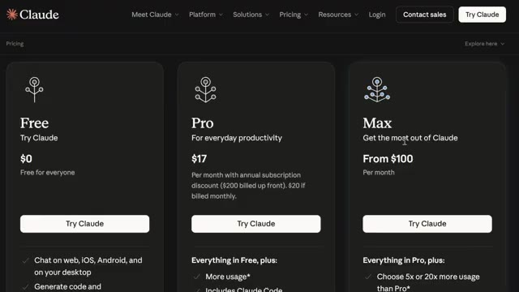
*⏱️ 00:10:42 — Page de tarification de Claude affichant les formules Free ($0), Pro ($17-$20) et Max (à partir de $100 par mois).*

---

### ⏱️ `[00:10:51 - 00:11:17]` | Segment #26

**🔊 Audio (Transcription Intégrale Mot pour Mot en Français) :**
> intelligence, sauf qu'il faut encore la surveiller, ouvrir le chat et entretenir soi-même la conversation. Donc, quand on met tout bout à bout, 20 à 300 dollars pour ChatGPT, 20 à 200 dollars pour Gemini, 100 à 200 dollars pour Claude, vous dépensez déjà de vraies sommes pour les abonnements supérieurs de n'importe lequel d'entre eux. La différence avec GrokBot à cette même tranche de prix de 200 à 300 dollars, c'est que vous ne payez pas pour une conversation plus intelligente.

**👁️ Analyse Visuelle d'Écran (gemini-3.5-flash-lite) :**
**Interface & Outils** : Pages de tarification (pricing pages) de sites web d'IA (Claude, Gemini, xAI/Cursor).

**Contenu textuel & Code** : Grilles de tarifs d'abonnements IA affichant des montants de 0$ à 300$ par mois et des fonctionnalités associées.

**Action / Démonstration** : Présentation et comparaison des coûts mensuels des différents abonnements d'intelligence artificielle.

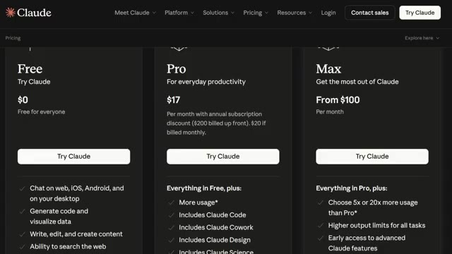
*⏱️ 00:10:57 — Page de tarification de Claude affichant les offres Free, Pro ($17-$20/mois) et Max (à partir de $100/mois).*

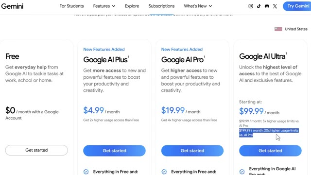
*⏱️ 00:11:04 — Page de tarification de Google Gemini montrant les formules Free, Google AI Plus ($4.99), Google AI Pro ($19.99) et Google AI Ultra ($99.99 à $199.99/mois).*

*⏱️ 00:11:11 — Page de tarification affichant les offres Cursor Ultra ($200/mois), SuperGrok Heavy ($300/mois) et Cursor Premium Teams ($120/siège/mois).*

---

### ⏱️ `[00:11:18 - 00:11:46]` | Segment #27

**🔊 Audio (Transcription Intégrale Mot pour Mot en Français) :**
> Vous payez pour quelque chose qui fonctionne 24h/24 et 7j/7 sans vous. Écoutez, 200 dollars, c'est beaucoup, et je ne vais pas faire semblant que ce n'est pas le cas. Ce n'est pas pour quelqu'un qui se lance tout juste dans la crypto avec un abonnement de 20 dollars. C'est pour les personnes qui dépensent déjà de l'argent réel en crédits API ou en abonnements multiples à des IA et qui veulent que tout soit regroupé en un seul système toujours actif. Si ce n'est pas encore votre cas, il n'y a aucun problème. Vous pouvez tirer énormément de valeur des outils gratuits et trader intelligemment quand même.

**👁️ Analyse Visuelle d'Écran (gemini-3.5-flash-lite) :**
**Interface & Outils** : Page web de tarification logicielle (style SaaS / xAI / Cursor).

**Contenu textuel & Code** : Tarifs affichés : Cursor Ultra à 200 $ / mois, SuperGrok Heavy à 300 $ / mois, et Cursor Premium Teams à 120 $ / seat / mois. Liste des fonctionnalités incluses pour chaque offre.

**Action / Démonstration** : Présentation des différentes formules d'abonnement et de leurs coûts mensuels correspondants.

*⏱️ 00:11:25 — Capture d'écran montrant une page de tarification avec différentes offres d'abonnement logiciel, mettant en avant l'offre à 200 dollars par mois.*

---

### ⏱️ `[00:11:46 - 00:12:19]` | Segment #28

**🔊 Audio (Transcription Intégrale Mot pour Mot en Français) :**
> Maintenant, avant de conclure, laissez-moi passer en revue une FAQ rapide parce que je sais que beaucoup d'entre vous vont se poser exactement ces questions dans les commentaires. En quoi GrokBot est-il différent des assistants IA ? Les bots ont leur propre ordinateur, donc ils peuvent travailler à l'intérieur de vos applications et de vos outils. Ils fonctionnent également en parallèle, 24 heures sur 24 et 7 jours sur 7, même lorsque votre ordinateur portable est fermé. Pour qui GrokBot est-il disponible aujourd'hui ? GrokBot est accessible aujourd'hui pour les abonnés de Cursor Ultra, Super Grok Heavy et Cursor Premium Team. GrokBot est-il disponible pour les entreprises ? Bientôt. Nous prévoyons d'ouvrir GrokBot aux équipes et aux entreprises

**👁️ Analyse Visuelle d'Écran (gemini-3.5-flash-lite) :**
**Interface & Outils** : Page web de FAQ (thème sombre)

**Contenu textuel & Code** : Texte de la FAQ : 'How is Grok Bot different from AI assistants? Bots have their own computer, so they can work inside your apps and tools. They also run in parallel, 24/7, even when your laptop is closed.' ainsi que d'autres questions fréquentes.

**Action / Démonstration** : Présentation des questions de la FAQ concernant Grok Bot.

*⏱️ 00:11:55 — Capture d'écran montrant une page de FAQ sur un site web, avec la question sur la différence entre Grok Bot et les assistants IA.*

---

### ⏱️ `[00:12:19 - 00:12:41]` | Segment #29

**🔊 Audio (Transcription Intégrale Mot pour Mot en Français) :**
> dans les semaines à venir. Pour l'instant, vous pouvez vous inscrire sur liste d'attente. Je mettrai le lien ci-dessous. Où est-ce que je parle à GrokBot ? Travailler avec GrokBot depuis votre bureau, macOS ou Windows, ou votre téléphone avec l'application iOS ? Est-ce que les bots partagent un seul ordinateur ? Oui. Chaque Grokbot partage un seul ordinateur cloud persistant. Vos bots partagent cette machine, les fichiers, le navigateur, les identifiants, afin de pouvoir se passer le relais et conserver le contexte.

**👁️ Analyse Visuelle d'Écran (gemini-3.5-flash-lite) :**
**Interface & Outils** : Page web FAQ avec design minimaliste sombre.

**Contenu textuel & Code** : Questions fréquentes (« FAQs »), notamment : « How is Grok Bot different from AI assistants? », « Who is Grok Bot available for today? », « Is Grok Bot available for enterprises? » avec le texte explicatif « Soon. We expect to open Grok Bot to teams and enterprises in the coming weeks. For now, you can join our waitlist here. »

**Action / Démonstration** : Navigation sur la page web pour illustrer la disponibilité prochaine de Grok Bot et l'accès à la liste d'attente.

*⏱️ 00:12:25 — Capture d'écran montrant la section FAQ d'un site web avec des questions sur Grok Bot et un lien vers une liste d'attente.*

---

### ⏱️ `[00:12:41 - 00:13:06]` | Segment #30

**🔊 Audio (Transcription Intégrale Mot pour Mot en Français) :**
> L'isolement est par utilisateur, et non par Grokbot. Comment Grokbot gère-t-il mes données et ma vie privée ? Grokbot utilise le même SSO, la même authentification et le même mode de confidentialité de Cursor auxquels vous faites déjà confiance. Votre ordinateur cloud est chiffré en transit et au repos avec une option de désactivation de l'entraînement. Les actions sensibles peuvent passer par une révision automatique avant d'être exécutées. Les administrateurs d'entreprise peuvent définir la prévention des pertes de données, les certificats, les proxys et les contrôles réseau au démarrage.

**👁️ Analyse Visuelle d'Écran (gemini-3.5-flash-lite) :**
**Interface & Outils** : Site web / Page de FAQ de Grok Bot.

**Contenu textuel & Code** : Section FAQ déployée affichant le texte sur la sécurité, l'authentification SSO, le chiffrement et le mode de confidentialité de Cursor.

**Action / Démonstration** : Lecture de la FAQ concernant la confidentialité des données et la sécurité du cloud computer.

*⏱️ 00:12:48 — Capture d'écran montrant la page web de présentation avec la FAQ abordant la gestion des données et de la vie privée par Grok Bot.*

---

### ⏱️ `[00:13:07 - 00:13:41]` | Segment #31

**🔊 Audio (Transcription Intégrale Mot pour Mot en Français) :**
> Très bien, et écoutez, au cours des prochaines années, deux types de traders existeront : ceux qui utilisent l'IA et ceux qui font encore tout manuellement. Même marché. Des résultats très différents. Voici comment vous mettre du bon côté de tout cela. J'ai rassemblé tout ce qui se trouve à l'intérieur de la communauté AI Trade Edge. Chaque prompt, chaque bot, chaque modèle, chaque guide étape par étape que j'utilise personnellement, tout en un seul endroit, et tout ce que je construirai à l'avenir sera ajouté directement dans le groupe dès sa sortie. Nous testons également des stratégies provenant de partout sur Internet, en les automatisant

**👁️ Analyse Visuelle d'Écran (gemini-3.5-flash-lite) :**
**Interface & Outils** : Interface web de la plateforme d'apprentissage Alex Carter Trading et interface du réseau social X.

**Contenu textuel & Code** : Liste des capacités d'automatisation et de lecture de graphiques via l'IA (lecture OHLCV, indicateurs techniques, contrôle des symboles et des unités de temps).

**Action / Démonstration** : Présentation des avantages compétitifs de l'IA dans le trading et démonstration des fonctionnalités de la plateforme logicielle.

*⏱️ 00:13:24 — Page Web de la plateforme Alex Carter Trading détaillant les fonctionnalités et le contrôle de TradingView par l'intelligence artificielle (78 outils disponibles).*

---

### ⏱️ `[00:13:41 - 00:14:17]` | Segment #32

**🔊 Audio (Transcription Intégrale Mot pour Mot en Français) :**
> en utilisant PineScript, en les exécutant en direct, et en partageant exactement ce qui fonctionne et ce qui ne fonctionne pas. Donc vous n'obtenez pas seulement des outils. Vous obtenez une opération de recherche en direct. À l'intérieur, il y a aussi un cours complet de trading agentique. 2,5 heures. Du débutant à l'expert. Aucune compétence en codage requise. D'ici la fin, vous aurez votre propre système de trading par IA fonctionnant en direct. Quelque chose que la plupart des traders particuliers ne savent même pas être possible en ce moment. 79,99 $ par mois. Un bon trade couvre ce montant. Et les 100 premiers membres bloquent ce tarif de façon permanente. Après cela, le prix augmente. Le lien est dans la

**👁️ Analyse Visuelle d'Écran (gemini-3.5-flash-lite) :**
**Interface & Outils** : TradingView, interface de cours en ligne, plateforme Whop

**Contenu textuel & Code** : Graphique Bitcoin/USD, indicateur RSI-VWAP, modules de cours (OpenClaw, Agentic Bots, Python Bot, Deploy to Hostinger VPS, Live-Ops Dashboard)

**Action / Démonstration** : Analyse technique d'un graphique de cryptomonnaie et présentation du programme de formation en trading agentique.

*⏱️ 00:13:50 — Graphique de trading affichant le cours du Bitcoin avec des indicateurs techniques et des signaux d'achat/vente.*

*⏱️ 00:13:59 — Interface de cours en ligne montrant différents modules sur le trading agentique et l'intelligence artificielle.*

---

### ⏱️ `[00:14:17 - 00:14:50]` | Segment #33

**🔊 Audio (Transcription Intégrale Mot pour Mot en Français) :**
> description. Vous ne pouvez vraiment pas vous permettre de rater ça. Donc ça c'est GrokBot. Ce que c'est, pourquoi je pense qu'il bat actuellement les alternatives pour un travail en continu, exactement comment le configurer, et comment vous pouvez le pointer directement vers votre trading et vos investissements de cryptos. Je vais continuer à tester ceci au cours des prochaines semaines et voir comment il tient le coup face aux conditions réelles du marché. Alors assurez-vous d'être abonnés et d'avoir activé les notifications car je partagerai des mises à jour au fur et à mesure. Et si vous voulez le guide complet étape par étape sur la façon de construire votre propre système de trading agentique en utilisant Claude, cette vidéo est

**👁️ Analyse Visuelle d'Écran (gemini-3.5-flash-lite) :**
**Interface & Outils** : Interface d'agent conversationnel IA (style interface de chat avec panneau latéral de gestion des bots).

**Contenu textuel & Code** : Analyses techniques de cryptomonnaies incluant des alertes de volume, des cassures de structure (BOS), des changements de caractère (CHoCH), et des prix cibles.

**Action / Démonstration** : Présentation de l'interface des bots de trading et affichage des résultats d'analyses automatisées en temps réel.

*⏱️ 00:14:33 — Image 2 (00:14:33) : Interface de l'assistant IA avec des analyses de marché détaillées pour différentes cryptomonnaies (SOL, PEPE, WIF, AVAX, XRP, LINK, DOGE, ETH, BTC).*

*⏱️ 00:14:42 — Image 3 (00:14:42) : Configuration d'un agent de recherche IA agissant comme un scanner de marché automatisé et analyste technique.*

---

### ⏱️ `[00:14:50 - 00:15:00]` | Segment #34

**🔊 Audio (Transcription Intégrale Mot pour Mot en Français) :**
> qui s'affiche également à l'écran. Allez voir ça ensuite. Si vous avez trouvé cela utile, laissez un pouce bleu. Cela aide vraiment la chaîne. Abonnez-vous si ce n'est pas déjà fait, et je vous dis à la prochaine.

**👁️ Analyse Visuelle d'Écran (gemini-3.5-flash-lite) :**
**Interface & Outils** : Aucune

**Contenu textuel & Code** : Aucun

**Action / Démonstration** : Aucune

---

