# 🎬 I Automated a 5-Minute Ranging Scalp Strategy in Seconds Using Claude

> **Chaîne** : [Alex Carter](https://www.youtube.com/@AlexCarterTrading)  
> **Lien YouTube** : [https://www.youtube.com/watch?v=3wPM91Xp2Mk](https://www.youtube.com/watch?v=3wPM91Xp2Mk)  
> **Date de publication** : 20261023  
> **Durée** : 00:11:50  
> **Identifiant vidéo** : `3wPM91Xp2Mk`  
> **Transcription & Analyse** : `whisper-v3-large-turbo+gemini-3.5-flash-lite`  

---

## 📌 Synthèse Exécutive & Outils

### 💡 Résumé

Cette vidéo aborde l'automatisation complète d'une stratégie de scalping en range sur l'unité de temps de 5 minutes, en s'appuyant sur des outils d'intelligence artificielle générative comme **Claude Code**. Destinée aux traders cherchant à éliminer la pénibilité du suivi manuel tout en évitant le bruit des graphiques en une minute, la méthode repose sur une logique de retour à la moyenne. L'objectif est d'exploiter les phases d'hésitation ou de latéralisation des marchés très liquides (comme Bitcoin ou Ethereum) pour capter des mouvements de prix entre les bornes extrêmes d'une fourchette, sans jamais lutter contre des tendances directionnelles puissantes.

L'analyse technique présentée combine trois indicateurs clés rigoureusement filtrés : les **bandes de Bollinger** pour matérialiser les limites dynamiques du range, l'**indice directionnel moyen (ADX)** pour s'assurer de l'absence de tendance forte, et le **Money Flow Index (MFI)** pour identifier les zones d'excès de liquidité et de volume. L'alignement de ces conditions techniques permet de repérer des configurations d'achat ou de vente au moment exact où le prix réintègre le range. 

Plutôt que de surveiller les graphiques en continu, la vidéo démontre comment exploiter **Claude** pour transcrire instantanément cette stratégie en un script **Pine Script** complet et fonctionnel pour **TradingView**. Ce processus d'ingénierie rapide permet non seulement de s'affranchir du code manuel, mais aussi de déployer des alertes et d'envisager la construction de bots de trading agentiques capables d'exécuter des ordres en temps réel sur des plateformes de contrats à terme sans friction excessive.

---

### 🛠️ Outils, Modèles & Logiciels Présentés

* **Claude / Claude Code** : Modèle d'intelligence artificielle et environnement de développement utilisé pour concevoir et générer instantanément l'intégralité du code Pine Script à partir d'un simple prompt textuel.
* **TradingView** : Plateforme graphique de référence utilisée pour l'analyse technique, le tracé des indicateurs (Bandes de Bollinger, ADX, MFI) et l'exécution/compilation des scripts de trading automatisés.
* **UBIT** : Échange de cryptomonnaies centralisé spécialisé dans le trading de contrats à terme perpétuels (USDT-M), offrant d'importants bonus d'inscription et des options de dépôt rapides.
* **Blofen** : Alternative boursière sans exigence de vérification KYC obligatoire pour le trading de base, permettant une accessibilité immédiate et des bonus adaptés aux nouveaux utilisateurs.
* **Grok Bots** : Agents conversationnels et d'automatisation mentionnés dans le cadre de la construction de bots de trading agentiques autonomes.
* **Pine Script** : Langage de programmation propriétaire de TradingView utilisé pour coder, backtester et automatiser les signaux d'achat et de vente de la stratégie.

---

### 🔑 Points Clés & Enseignements Stratégiques

* **Logique de retour à la moyenne** : La stratégie se concentre exclusivement sur les marchés en range, où le prix oscille entre un plancher et un plafond, en visant systématiquement la ligne médiane des bandes de Bollinger comme cible de profit.
* **Filtrage impératif de la tendance avec l'ADX** : L'Indice Directionnel Moyen (ADX) sert de filtre de sécurité absolu ; un ADX inférieur à 20 valide l'absence de tendance et autorise le scalping, tandis qu'une valeur supérieure à 25 l'interdit formellement pour éviter les faux signaux destructeurs.
* **Paramétrage des Bandes de Bollinger** : Configurées avec une longueur de 20 et un multiplicateur d'écart type de 2, elles délimitent les zones de sur-extension du prix (plafond supérieur et plancher inférieur).
* **Intégration du volume via le MFI** : Le Money Flow Index (longueur 14) joue le rôle d'un RSI pondéré par le volume, confirmant les retournements lorsque l'actif sort des bornes extrêmes (sous 20 en survente, au-dessus de 80 en surachat) avant de réintégrer le range.
* **Règles d'entrée strictes à l'achat (Long)** : L'ADX doit être sous 20, le prix doit clôturer sous la bande de Bollinger inférieure avant qu'une bougie de confirmation ne réintègre la bande, et le MFI doit croiser à la hausse depuis la zone de survente.
* **Règles d'entrée strictes à la vente (Short)** : L'ADX est inférieur à 20, le prix clôture au-dessus de la bande supérieure avant d'être réintégré par la bougie suivante, et le MFI amorce une baisse depuis la zone de surachat.
* **Gestion rigoureuse du risque (Risk Management)** : Le stop-loss est placé de manière sécurisée au-delà de l'extrême de la bougie de signal ou à une distance équivalente à une fois l'ATR (Average True Range) au-delà de la bande.
* **Sortie d'urgence basée sur la volatilité** : Si l'ADX dépasse le seuil critique de 25 pendant qu'une position est ouverte, le trader doit clôturer immédiatement le trade, car cela indique une cassure imminente du range.
* **Automatisation par l'IA générative** : L'utilisation de Claude permet de s'affranchir du codage manuel en traduisant une logique de trading complexe en un script Pine Script prêt à l'emploi en quelques secondes.
* **Déploiement et alertes sur TradingView** : Le code généré est injecté dans l'éditeur Pine Script de TradingView pour visualiser instantanément les flèches de signal (vertes pour l'achat, rouges pour la vente) et configurer des alertes automatisées.
* **Sécurité des transferts de fonds** : Lors de l'alimentation des comptes d'échange (notamment via le réseau TRC20 pour l'USDT en raison de sa rapidité et de ses faibles frais), il est impératif d'effectuer un dépôt test initial de 10 à 20 dollars pour valider l'adresse et le réseau.

---

## ⏱️ Chronologie & Transcription Complète Audio & Visuelle (Mot pour Mot)

### ⏱️ `[00:00:00 - 00:00:19]` | Segment #01

**🔊 Audio (Transcription Intégrale Mot pour Mot en Français) :**
> Dans cette vidéo, je vous donne une stratégie de scalping de cinq minutes conçue pour les marchés en range, et je vais vous montrer comment j'ai automatisé le tout en utilisant Claude. Donc, si vous ne supportez pas d'attendre des heures ou des jours pour un setup, mais que vous ne voulez pas du graphique d'une minute où vous entrez et sortez en quelques secondes, le graphique de cinq minutes vous offre un peu de répit.

**👁️ Analyse Visuelle d'Écran (gemini-3.5-flash-lite) :**
**Interface & Outils** : TradingView, Terminal de commande CLI (Claude Code), Blofin / Bybit

**Contenu textuel & Code** : Prompt utilisateur décrivant une stratégie de scalping en range basée sur les Bandes de Bollinger (20,2), l'ADX (14) et le Money Flow Index (14).

**Action / Démonstration** : Sélection d'une zone de consolidation sur un graphique de prix et rédaction d'un prompt d'automatisation d'indicateur.

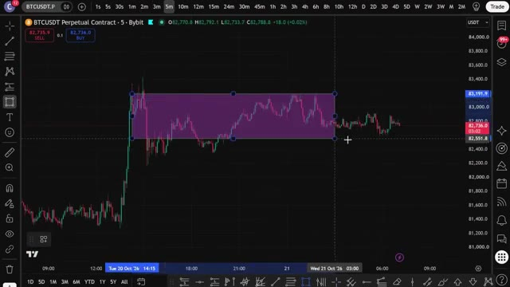
*⏱️ 00:00:05 — Graphique TradingView en unité de temps 5 minutes montrant une zone de range horizontale sur le contrat perpétuel BTCUSDT.*

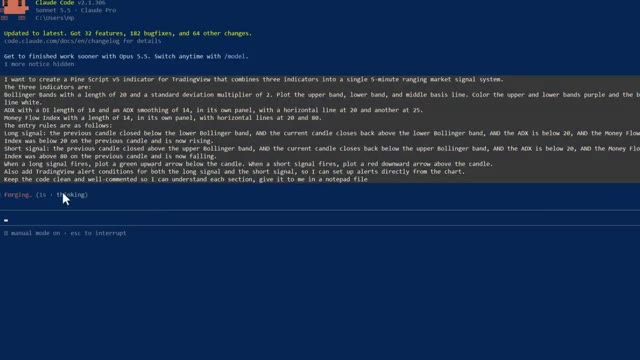
*⏱️ 00:00:09 — Interface de terminal Claude Code affichant un prompt détaillé pour créer un indicateur Pine Script v5 combinant Bandes de Bollinger, ADX et MFI.*

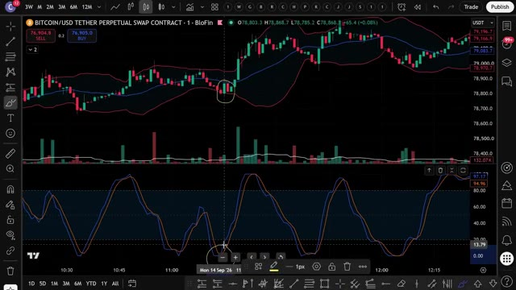
*⏱️ 00:00:14 — Graphique de trading montrant un indicateur personnalisé avec des Bandes de Bollinger et des oscillateurs en sous-fenêtre pour identifier les retournements en range.*

---

### ⏱️ `[00:00:19 - 00:00:40]` | Segment #02

**🔊 Audio (Transcription Intégrale Mot pour Mot en Français) :**
> Ça fonctionne sur n'importe quelle paire de liquides avec des indicateurs que vous n'utilisez probablement jamais. Restez jusqu'à la fin, car je vais vous montrer comment obtenir tous mes prompts et stratégies et comment construire votre propre bot de trading agentique avec Claude. Entrons donc dans le vif du sujet. Très bien, les gars, étape numéro une, inscrivez-vous sur un échange. Pour cette stratégie, nous allons utiliser UBIT.

**👁️ Analyse Visuelle d'Écran (gemini-3.5-flash-lite) :**
**Interface & Outils** : TradingView, site web de cours de trading, interface de courtier/plateforme YUBIT.

**Contenu textuel & Code** : Graphique de prix BTCUSDT en chandelier japonais 5m, indicateur technique RMS et oscillateurs, statistiques de performance de bots IA sur Polymarket et Hyperliquid.
[DESC_IMAGE_3 non retenue]

**Action / Démonstration** : Présentation d'un graphique technique avec indicateur et démonstration des performances de trading par l'intelligence artificielle (Claude).

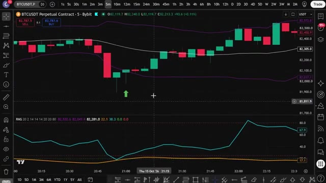
*⏱️ 00:00:24 — Graphique TradingView affichant le contrat perpétuel BTCUSDT en timeframe 5 minutes avec des indicateurs techniques et un signal d'achat vert.*

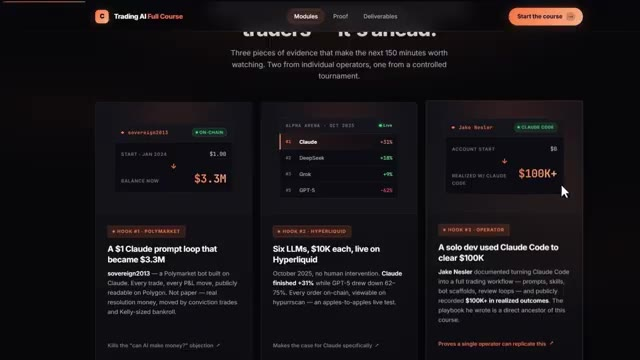
*⏱️ 00:00:29 — Interface de cours "Trading AI" présentant trois sections comparatives de performances de bots de trading alimentés par IA (Claude, DeepSeek, Grok, GPT-5).*

---

### ⏱️ `[00:00:40 - 00:01:12]` | Segment #03

**🔊 Audio (Transcription Intégrale Mot pour Mot en Français) :**
> C'est l'un de mes échanges préférés pour le trading de contrats à terme en ce moment, et ils ont de sérieux bonus pour les nouveaux utilisateurs, jusqu'à 50 000 $ de bonus rien qu'en vous inscrivant et en faisant du trading en utilisant mon lien ci-dessous. Si UBIT ne vous convient pas, vous pouvez utiliser Blofen comme alternative. Blofen ne requiert pas de vérification KYC obligatoire pour le trading de base, ce qui signifie que vous pouvez commencer à trader immédiatement. De plus, les nouveaux utilisateurs peuvent gagner jusqu'à 5 000 USDT grâce à des bonus sur les dépôts et le volume de trading. Je mettrai les deux liens ci-dessous. Une fois

**👁️ Analyse Visuelle d'Écran (gemini-3.5-flash-lite) :**
**Interface & Outils** : Interfaces web des plateformes d'échange de cryptomonnaies YUBIT et BloFin.

**Contenu textuel & Code** : Offres de bonus de bienvenue pour nouveaux utilisateurs, paliers de récompenses en USDT et conditions de volume de trading sur contrats à terme.

**Action / Démonstration** : Navigation sur les pages de parrainage et de bonus d'inscription de plateformes d'échange de crypto-actifs.

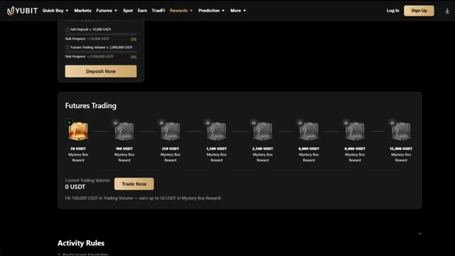
*⏱️ 00:00:48 — Page des récompenses (Rewards) de la plateforme de trading YUBIT affichant le programme de bonus sur le volume de contrats à terme (Futures Trading).*

*⏱️ 00:00:56 — Page d'inscription de l'échange de cryptomonnaies BloFin, présentant un partenariat avec Mister Crypto et un bonus de bienvenue pouvant aller jusqu'à 5 000 $.*

*⏱️ 00:01:04 — Page des offres exclusives pour les nouveaux utilisateurs sur la plateforme BloFin, affichant un bonus de bienvenue pouvant atteindre 5 000 USDT.*

---

### ⏱️ `[00:01:12 - 00:01:35]` | Segment #04

**🔊 Audio (Transcription Intégrale Mot pour Mot en Français) :**
> vous êtes sur la page UBIT, vous pouvez vous inscrire avec votre adresse e-mail, votre numéro de téléphone, ou vous connecter via Google ou Apple ID. Pour ce tutoriel, je vais utiliser l'e-mail. Il vous suffit d'entrer vos coordonnées, de créer un mot de passe fort, d'accepter les conditions d'utilisation et de cliquer sur s'inscrire. Entrez le code de vérification par e-mail et votre compte est prêt. Tout le processus prend moins de 30 secondes.

**👁️ Analyse Visuelle d'Écran (gemini-3.5-flash-lite) :**
**Interface & Outils** : Site web de la plateforme d'échange UBIT.

**Contenu textuel & Code** : Formulaire d'inscription avec champs pour l'email, le mot de passe, le code de parrainage (ALEX) et les options de connexion sociale.

**Action / Démonstration** : Saisie des informations d'identification et démonstration du processus de création de compte sur UBIT.

*⏱️ 00:01:18 — Page d'inscription de la plateforme UBIT avec les options de connexion par email, mobile et boutons Apple/Google.*

*⏱️ 00:01:24 — Saisie de l'adresse email dans le formulaire d'inscription de la plateforme UBIT.*

---

### ⏱️ `[00:01:35 - 00:01:59]` | Segment #05

**🔊 Audio (Transcription Intégrale Mot pour Mot en Français) :**
> Et gardez à l'esprit que UBIT est une plateforme sans KYC. Vous n'avez pas besoin de compléter la vérification d'identité pour commencer à trader. Cela la rend accessible même dans les régions restreintes, et cela signifie que vous pouvez commencer à trader presque instantanément après vous être inscrit. Allez dans votre portefeuille et cliquez sur dépôt. Sélectionnez la cryptomonnaie que vous souhaitez déposer. L'USDT est idéal pour le trading. Sélectionnez ensuite votre réseau de dépôt.

**👁️ Analyse Visuelle d'Écran (gemini-3.5-flash-lite) :**
**Interface & Outils** : Site web de la plateforme de trading UBIT (interfaces d'articles, page d'accueil et module de dépôt).

**Contenu textuel & Code** : Texte descriptif sur l'onboarding et l'absence de KYC, menus de navigation de la plateforme UBIT, options de dépôt de cryptomonnaies (USDT, BTC, ETH, WLFI, XRP).

**Action / Démonstration** : Navigation sur le site web d'UBIT, mise en avant des conditions d'inscription sans vérification d'identité et présentation de la page de dépôt.

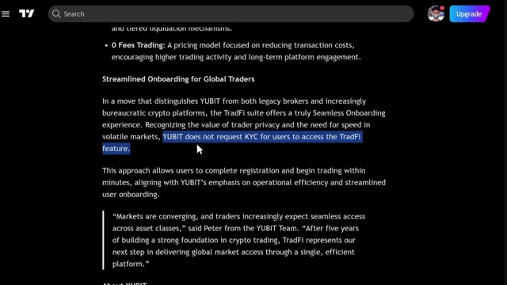
*⏱️ 00:01:41 — Article sur l'absence de KYC pour accéder aux fonctionnalités TradFi de la plateforme UBIT.*

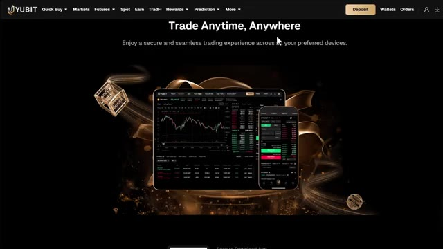
*⏱️ 00:01:47 — Page d'accueil de la plateforme UBIT affichant le slogan « Trade Anytime, Anywhere » avec des aperçus d'applications sur tablette et mobile.*

*⏱️ 00:01:53 — Page de dépôt de la plateforme UBIT permettant de sélectionner une cryptomonnaie (USDT, BTC, ETH) et un réseau.*

---

### ⏱️ `[00:01:59 - 00:02:35]` | Segment #06

**🔊 Audio (Transcription Intégrale Mot pour Mot en Français) :**
> Je recommande TRC20. C'est rapide et les frais sont très bas. Vous verrez alors votre adresse de dépôt personnelle. Copiez-la soigneusement. Allez sur votre échange ou portefeuille actuel. Collez l'adressez et envoyez vos fonds. Envoyez toujours un petit montant test d'abord, peut-être 10 à 20 dollars, juste pour confirmer que tout arrive correctement avant d'envoyer le montant complet. C'est très important. Envoyer sur le mauvais réseau peut signifier perdre vos fonds. Si vous n'avez pas encore de crypto et que vous voulez en acheter directement sur UBIT, c'est également possible. Mais pour cela, vous devrez d'abord compléter la KYC. Allez sur l'icône de votre profil sur

**👁️ Analyse Visuelle d'Écran (gemini-3.5-flash-lite) :**
**Interface & Outils** : Interface web d'échange de cryptomonnaies (Yubit).

**Contenu textuel & Code** : Formulaires de dépôt, de retrait et d'achat rapide de cryptomonnaies (USDT, AED).

**Action / Démonstration** : Navigation dans les menus de dépôt, de retrait et d'achat de la plateforme d'échange.

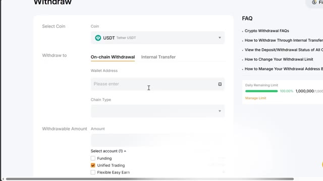
*⏱️ 00:02:08 — Formulaire de retrait de cryptomonnaie (Withdraw) avec sélection de l'USDT et champ pour l'adresse du portefeuille.*

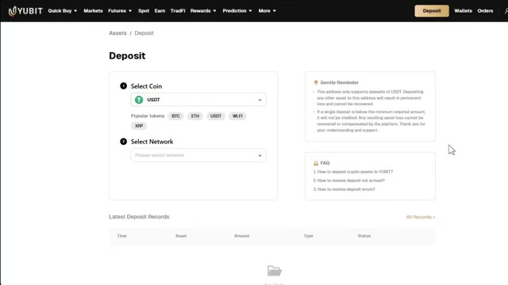
*⏱️ 00:02:17 — Interface de dépôt de la plateforme Yubit avec sélection de la cryptomonnaie USDT et du réseau.*

*⏱️ 00:02:26 — Page d'accueil de la plateforme Yubit pour l'achat et la vente de cryptomonnaies avec module de conversion rapide (Pay / Receive).*

---

### ⏱️ `[00:02:35 - 00:03:10]` | Segment #07

**🔊 Audio (Transcription Intégrale Mot pour Mot en Français) :**
> la page d'accueil et cliquez sur KYC. Cliquez sur vérifier maintenant. Fournissez votre e-mail, vos informations personnelles, vos documents de vérification et un selfie. Une fois que c'est approuvé, vous pouvez utiliser l'option d'achat rapide sur UBIT pour acheter des cryptos directement avec de monnaie fiat en utilisant une carte de crédit ou de débit. Si vous avez déjà des cryptos sur un autre échange ou portefeuille, vous pouvez ignorer complètement le KYC et faire simplement un dépôt direct, ce qui est l'option la plus rapide pour la plupart des gens. Cliquez sur futures dans la barre de navigation supérieure et cliquez sur USDT-M. Cela vous amènera à l'interface de trading de futures d'UBIT. Maintenant, il se peut

**👁️ Analyse Visuelle d'Écran (gemini-3.5-flash-lite) :**
**Interface & Outils** : Site web de la plateforme d'échange de cryptomonnaies YUBIT (pages de vérification KYC et de dépôt).

**Contenu textuel & Code** : QR code de vérification Sumsub, liens de redirection mobile, sélecteurs de cryptomonnaies et de réseaux, ainsi que les historiques de dépôt.

**Action / Démonstration** : Navigation sur la plateforme YUBIT pour effectuer la vérification d'identité et consulter les options de dépôt de fonds.

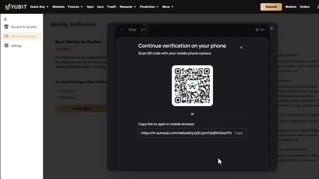
*⏱️ 00:02:44 — L'interface de la plateforme YUBIT affichant une étape de vérification d'identité (KYC) avec un QR code pour continuer sur mobile.*

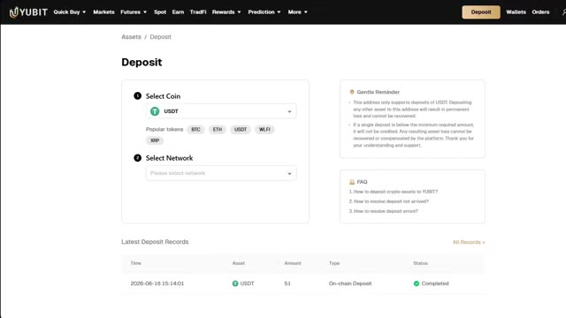
*⏱️ 00:02:53 — La page de dépôt de la plateforme YUBIT permettant de sélectionner une cryptomonnaie (USDT, BTC, ETH) et un réseau.*

---

### ⏱️ `[00:03:10 - 00:03:44]` | Segment #08

**🔊 Audio (Transcription Intégrale Mot pour Mot en Français) :**
> ça a l'air un peu intimidant au début, mais je vais décortiquer chaque section pour que ce soit parfaitement clair. En haut à gauche, vous avez le sélecteur de paires de trading. C'est ici que vous choisissez quel actif trader. UBIT propose plus de 500 paires de trading, du bitcoin et de l'ethereum jusqu'aux meme coins et aux altcoins majeurs. Vous pouvez choisir entre les perpétuels margés en USDT et les perpétuels margés en crypto, qui sont des trades réglés dans votre propre crypto au lieu de l'USDT. Au centre se trouve le graphique des prix, propulsé par TradingView, avec tous les outils de dessin et les indicateurs techniques dont vous avez besoin pour l'analyse.

**👁️ Analyse Visuelle d'Écran (gemini-3.5-flash-lite) :**
**Interface & Outils** : Interface web de l'échange de cryptomonnaies YUBIT (section Futures).

**Contenu textuel & Code** : Liste des paires de trading (ETHUSDT, BTCUSDT, SOLUSDT, XRPUSDT, etc.), prix actuels, variations sur 24h, graphique des chandeliers japonais et carnet d'ordres en temps réel.

**Action / Démonstration** : Navigation et sélection d'une paire de trading dans le menu déroulant de gauche sur la plateforme YUBIT.

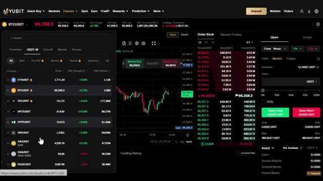
*⏱️ 00:03:18 — Interface de trading de la plateforme YUBIT affichant le carnet d'ordres, le graphique des prix et le sélecteur de paires avec les cryptomonnaies principales.*

---

### ⏱️ `[00:03:44 - 00:04:20]` | Segment #09

**🔊 Audio (Transcription Intégrale Mot pour Mot en Français) :**
> Sur le côté droit se trouve le carnet d'ordres, qui montre tous les ordres d'achat et de vente en direct sur le marché. Et en bas se trouve votre panneau de gestion des ordres. C'est ici que vous suivez vos positions ouvertes, vos ordres ouverts et votre historique de trading. Tout ce dont vous avez besoin est ici sur un seul écran. Très bien, avant d'aborder les indicateurs, une chose rapide. Si vous n'avez pas encore TradingView, cliquez sur le lien dans la description ci-dessous. Si vous achetez la version pro, vous obtiendrez une réduction et cela aide vraiment énormément la chaîne. Très bien, passons aux choses sérieuses. Nous allons trader du Bitcoin USDT sur le graphique en cinq minutes. Mais honnêtement, cela fonctionne tout aussi bien sur Ethereum,

**👁️ Analyse Visuelle d'Écran (gemini-3.5-flash-lite) :**
**Interface & Outils** : Yubit, TradingView

**Contenu textuel & Code** : Carnet d'ordres en direct, graphique de prix du Bitcoin, panneau de gestion des ordres, soldes et informations de contrat.

**Action / Démonstration** : Présentation de l'interface de trading, des carnets d'ordres et du panneau de gestion des positions.

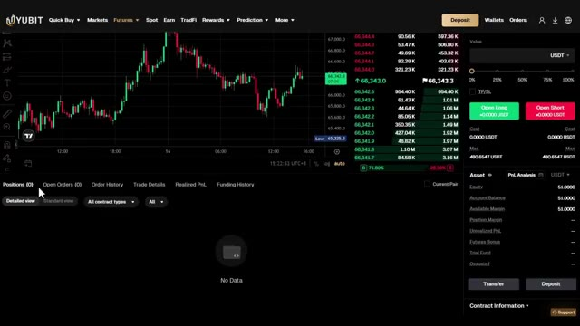
*⏱️ 00:03:53 — Interface de trading Yubit montrant un graphique de prix en chandeliers, un carnet d'ordres en direct à droite et un panneau de gestion des positions en bas.*

---

### ⏱️ `[00:04:20 - 00:04:50]` | Segment #10

**🔊 Audio (Transcription Intégrale Mot pour Mot en Français) :**
> Solana, ou toute autre paire majeure liquide sur n'importe quel marché. La logique ne change pas. Il s'agit d'une stratégie de retour à la moyenne dans un range. Quand le marché est bloqué en latéral, le prix ne cesse de rebondir entre le haut et le bas du range. Nous ne courons pas après le prix. Nous attendons qu'il touche les limites, nous confirmons que le marché est vraiment en range, nous confirmons qu'il est étiré, et nous le controns en direction du milieu. La règle la plus importante : cela ne fonctionne que lorsque le marché est en range. Dans une forte tendance, contrer les limites va vous détruire.

**👁️ Analyse Visuelle d'Écran (gemini-3.5-flash-lite) :**
**Interface & Outils** : TradingView (ou interface de graphique intégrée Bybit)

**Contenu textuel & Code** : Paire BTCUSDT Perpetual Contract, unité de temps 5 minutes, rectangle violet délimitant la zone de range (support et résistance).

**Action / Démonstration** : Traçage et ajustement d'un rectangle de consolidation sur le graphique pour identifier la borne haute et la borne basse du range horizontal.

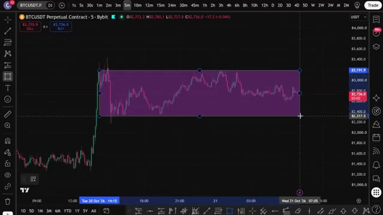
*⏱️ 00:04:28 — Un graphique en chandeliers japonais montrant un range de prix avec une zone rectangulaire violette tracée pour matérialiser la consolidation latérale.*

---

### ⏱️ `[00:04:50 - 00:05:27]` | Segment #11

**🔊 Audio (Transcription Intégrale Mot pour Mot en Français) :**
> Donc la première chose que nous faisons est de filtrer pour cela. Cette stratégie utilise trois indicateurs empilés ensemble. L'indicateur numéro un est les bandes de Bollinger. Celles-ci marquent les limites de la fourchette. La bande supérieure est notre plafond, la bande inférieure est notre plancher, et la ligne du milieu est la juste valeur que nous visons. Pour l'activer, allez dans Indicateurs en haut de votre graphique, recherchez les bandes de Bollinger, et cliquez dessus pour l'ajouter. Ensuite, cliquez sur la petite icône de paramètres à côté. Définissez la longueur à 20 et le multiplicateur d'écart type à 2. Cliquez sur OK et vous verrez les trois bandes tracées sur votre graphique. Indicateur

**👁️ Analyse Visuelle d'Écran (gemini-3.5-flash-lite) :**
**Interface & Outils** : Graphique de trading (interface de type TradingView / Bybit).

**Contenu textuel & Code** : Paire BTCUSDT Perpetual Contract - 5m, Bandes de Bollinger (BB 20 SMA close 2), bougies japonaises vertes et rouges.

**Action / Démonstration** : Analyse visuelle des bandes de Bollinger agissant comme des limites de fourchette (plafond supérieur et plan inférieur).

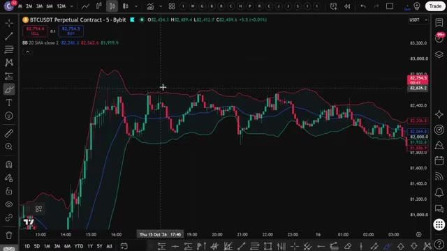
*⏱️ 00:04:59 — Graphique en chandeliers japonais affichant le contrat perpétuel BTCUSDT avec les bandes de Bollinger superposées.*

---

### ⏱️ `[00:05:27 - 00:05:49]` | Segment #12

**🔊 Audio (Transcription Intégrale Mot pour Mot en Français) :**
> Le numéro deux est l'ADX, l'indice directionnel moyen. C'est notre filtre de range. Il ne vous indique pas la direction. Il vous indique la force de la tendance. Quand l'ADX est inférieur à 20, le marché n'a pas de réelle tendance. Il est en range. C'est exactement à ce moment-là que nous sommes autorisés à trader. Si l'ADX est supérieur à 25, nous ne faisons rien.

**👁️ Analyse Visuelle d'Écran (gemini-3.5-flash-lite) :**
**Interface & Outils** : Graphique TradingView intégré à Bybit

**Contenu textuel & Code** : Indicateurs techniques affichés : Bandes de Bollinger (BB 20 SMA close 2) sur le graphique principal des prix et l'indice directionnel moyen (ADX 14 14) dans le panneau inférieur avec une ligne de seuil horizontale.

**Action / Démonstration** : Analyse technique du cours du Bitcoin montrant la transition entre une phase de forte volatilité/tendance et une phase de consolidation/range où l'ADX évolue à de faibles niveaux.

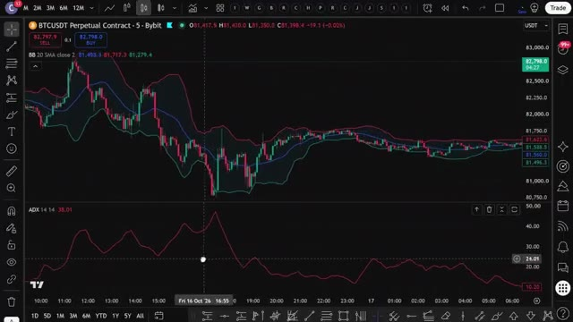
*⏱️ 00:05:32 — Graphique TradingView en unité de temps 5 minutes pour le contrat perpétuel BTCUSDT sur Bybit, affichant les bandes de Bollinger et l'indicateur ADX en sous-fenêtre.*

---

### ⏱️ `[00:05:49 - 00:06:11]` | Segment #13

**🔊 Audio (Transcription Intégrale Mot pour Mot en Français) :**
> Pour l'activer, allez à nouveau dans les indicateurs, recherchez l'ADX et cliquez dessus. Choisissez l'indice directionnel moyen, et non la version DMI. Cliquez sur l'icône des paramètres et définissez le lissage de l'ADX sur 14 et la longueur du DI sur 14. Cliquez sur OK et vous le verrez s'afficher dans son propre panneau. Ajoutez une ligne horizontale à 20 pour pouvoir le voir clairement.

**👁️ Analyse Visuelle d'Écran (gemini-3.5-flash-lite) :**
**Interface & Outils** : Graphique TradingView.

**Contenu textuel & Code** : Menu de recherche d'indicateurs avec "adx" saisi dans la barre de recherche et l'option "Average directional index" sélectionnée.

**Action / Démonstration** : Recherche et sélection de l'indicateur ADX dans le menu des indicateurs.

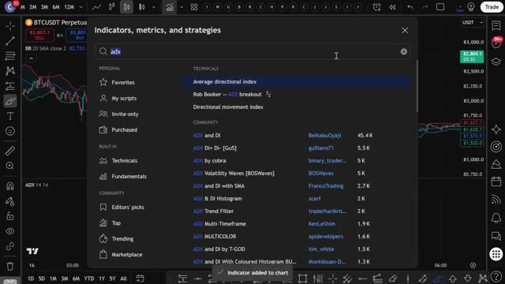
*⏱️ 00:05:55 — Fenêtre de recherche des indicateurs sur un graphique TradingView montrant la recherche de l'ADX.*

---

### ⏱️ `[00:06:11 - 00:06:30]` | Segment #14

**🔊 Audio (Transcription Intégrale Mot pour Mot en Français) :**
> L'indicateur numéro trois est le Money Flow Index ou MFI. Pensez-y comme à un RSI qui intègre le volume. Il vous montre donc quand le prix est étiré et que l'argent est réellement en train de s'échapper. En dessous de 20, c'est en survente, au-dessus de 80, c'est en surachat. Pour l'activer, allez dans les indicateurs, recherchez Money Flow Index et cliquez dessus.

**👁️ Analyse Visuelle d'Écran (gemini-3.5-flash-lite) :**
**Interface & Outils** : Graphique TradingView intégré (BTCUSDT Perpetual Contract, Bybit).

**Contenu textuel & Code** : Indicateurs techniques : Bandes de Bollinger (BB), ADX (14) et Money Flow Index (MFI 14) avec les seuils de survente et surachat.

**Action / Démonstration** : Présentation visuelle et explication de l'indicateur Money Flow Index (MFI) sur le graphique.

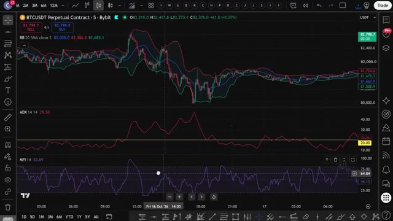
*⏱️ 00:06:16 — Un graphique de trading affichant le cours du BTCUSDT en chandeliers, ainsi que les indicateurs Bollinger Bands, ADX et Money Flow Index (MFI) en bas.*

---

### ⏱️ `[00:06:30 - 00:06:49]` | Segment #15

**🔊 Audio (Transcription Intégrale Mot pour Mot en Français) :**
> Cliquez sur l'icône des paramètres et définissez la longueur sur 14. Cliquez sur ok et vous le verrez tracé dans son propre panneau avec les niveaux 20 et 80. Voici ce que vous recherchez réellement. Pour une configuration acheteuse, le DX est inférieur à 20, donc le marché évolue en range. Le prix clôture sous la bande de Bollinger inférieure, puis la bougie suivante clôture à nouveau à l'intérieur de la bande.

**👁️ Analyse Visuelle d'Écran (gemini-3.5-flash-lite) :**
**Interface & Outils** : Graphique TradingView sur plateforme Bybit.

**Contenu textuel & Code** : Indicateurs techniques affichés : Bollinger Bands (BB 20 SMA close 2), ADX (14 14) avec le niveau 20 mis en évidence, et MFI (14).

**Action / Démonstration** : Analyse graphique de la configuration du marché montrant l'oscillateur ADX sous le niveau 20, indiquant un marché en range.

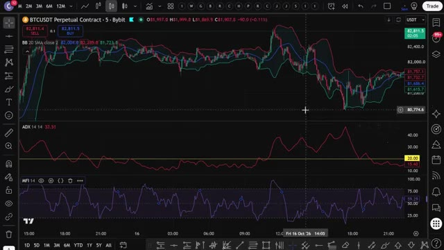
*⏱️ 00:06:35 — Un graphique TradingView affichant le cours du Bitcoin (BTCUSDT) en unités de 5 minutes sur Bybit, avec les indicateurs techniques Bollinger Bands, ADX configuré avec une longueur de 14 et un niveau horizontal à 20, ainsi que le MFI en bas.*

---

### ⏱️ `[00:06:50 - 00:07:25]` | Segment #16

**🔊 Audio (Transcription Intégrale Mot pour Mot en Français) :**
> Le MFI était sous 20 lors du mouvement et commence à remonter. Les trois ensemble signifient que la baisse a été exagérée, le range est intact, et les acheteurs reviennent simplement sur le plancher. Pour un setup vendeur, le DX est sous 20, donc le marché est en range. Le prix clôture au-dessus de la bande de Bollinger supérieure, puis la bougie suivante clôture de nouveau à l'intérieur de la bande. Le MFI était au-dessus de 80 lors du mouvement et commence à redescendre. Les trois ensemble signifient que la poussée a été exagérée, le range est intact, et les vendeurs viennent de prendre le contrôle au plafond. Pour la gestion de votre trade, votre cible est la ligne de Bollinger du milieu, c'est tout le principe d'un trade en range, placez votre stop loss

**👁️ Analyse Visuelle d'Écran (gemini-3.5-flash-lite) :**
**Interface & Outils** : TradingView (Graphique de prix et indicateurs techniques)

**Contenu textuel & Code** : Paire BTCUSDT Perpetual Contract (Bybit, TF 5 min), bandes de Bollinger, outil de position de trading (Closed PnL : 195.4, ratio risque/rendement : 1), indicateurs secondaires dans les sous-fenêtres incluant le MFI avec un seuil horizontal à 20 et des zones surlignées.

**Action / Démonstration** : Analyse graphique de la configuration du MFI sous la ligne des 20 et de l'exécution d'un trade long sur le plancher du range.

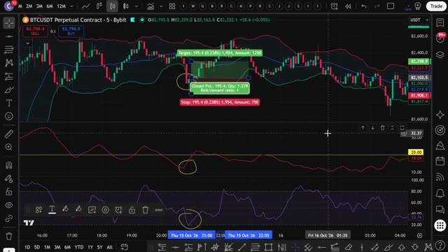
*⏱️ 00:06:59 — Graphique en chandeliers japonais du contrat perpétuel BTCUSDT en unité de temps de 5 minutes sur TradingView, illustrant un setup de trading avec un indicateur de momentum (MFI) sous le niveau 20 et des zones encerclées en jaune.*

---

### ⏱️ `[00:07:25 - 00:08:00]` | Segment #17

**🔊 Audio (Transcription Intégrale Mot pour Mot en Français) :**
> au-delà de l'extrême de la bougie de signal ou environ une fois l'ATR au-delà de la bande et si l'ADX dépasse 25 pendant que vous êtes dans le trade, sortez car la fourchette est en train de casser. Lorsque les trois conditions s'alignent sur le graphique de cinq minutes, c'est votre signal. Simple sur le papier, mais surveiller l'alignement de trois conditions manuellement bougie après bougie toute la journée, c'est épuisant, ce qui est exactement la raison pour laquelle je ne voulais plus le faire manuellement. Donc maintenant vous comprenez exactement comment cette stratégie fonctionne manuellement. Mais c'est là que ça devient vraiment intéressant. Au lieu de surveiller les graphiques toute la journée

**👁️ Analyse Visuelle d'Écran (gemini-3.5-flash-lite) :**
**Interface & Outils** : Graphique TradingView sur l'interface de Bybit.

**Contenu textuel & Code** : Prix du BTCUSDT (contrat perpétuel), bougies en 5 minutes, bandes de Bollinger (ou indicateur similaire de canaux de volatilité), ADX (Average Directional Index) dans le panneau inférieur avec un niveau seuil, et un oscillateur (RSI ou Stochastique) en bas.

**Action / Démonstration** : Analyse technique du graphique illustrant la stratégie de trading basée sur l'alignement des conditions (bandes, ADX et oscillateur) sur l'unité de temps 5 minutes.

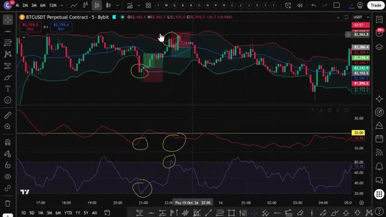
*⏱️ 00:07:34 — Un graphique de trading affichant les bougies de prix BTCUSDT en unité de 5 minutes avec des indicateurs techniques, montrant des cercles jaunes soulignant des signaux d'entrée et de sortie sur les indicateurs et les prix.*

---

### ⏱️ `[00:08:00 - 00:08:33]` | Segment #18

**🔊 Audio (Transcription Intégrale Mot pour Mot en Français) :**
> et de faire cela à l'œil. J'ai donné cette stratégie exacte à Claude et je lui ai demandé de m'écrire un script Pine complet. Pour que TradingView puisse détecter automatiquement ces signaux pour moi. Et voici le prompt que j'utilise. Je vais l'afficher à l'écran dès maintenant pour que vous puissiez le copier exactement. C'est tout. C'est le prompt complet. Vous collez ça dans Claude. J'utilise Claude Code ici. Et en quelques secondes, il crache un script Pine complet et fonctionnel dans un fichier bloc-notes. Maintenant, ce prompt exact ainsi que le script Pine utilisé dans cette vidéo sont disponibles dans mon groupe privé. Vous trouverez le lien ci-dessous. Une fois

**👁️ Analyse Visuelle d'Écran (gemini-3.5-flash-lite) :**
**Interface & Outils** : TradingView, éditeur de texte/document, Explorateur de fichiers Windows.
[DESC_IMAGE_1] Bandes de Bollinger, indicateur technique, cours du Bitcoin en graphique chandelier.
[DESC_IMAGE_2] Prompt textuel complet spécifiant les règles d'entrée (Long et Short) basées sur les bandes de Bollinger, l'ADX et le Money Flow Index.
[DESC_IMAGE_3] Liste de fichiers de code source pour le trading (fichiers PINE, Python, JSON).

**Contenu textuel & Code** : Explications orales des stratégies et mise en contexte méthodologique du marché.

**Action / Démonstration** : Présentation de la stratégie graphique, affichage du prompt exact fourni à l'intelligence artificielle, et navigation dans le dossier de scripts.

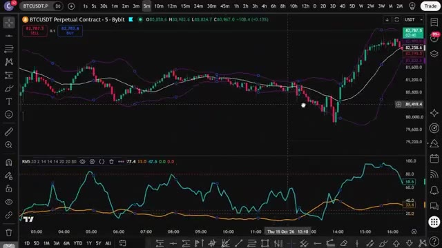
*⏱️ 00:08:08 — Graphique TradingView en unité de temps 5 minutes sur la paire BTCUSDT montrant les bandes de Bollinger et un indicateur technique en sous-fenêtre.*

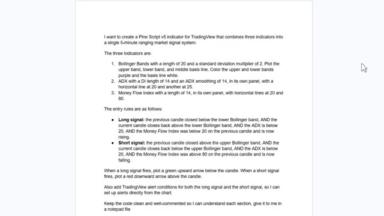
*⏱️ 00:08:17 — Document texte affichant le prompt détaillé destiné à Claude pour générer un indicateur Pine Script v5 combinant bandes de Bollinger, ADX et MFI.*

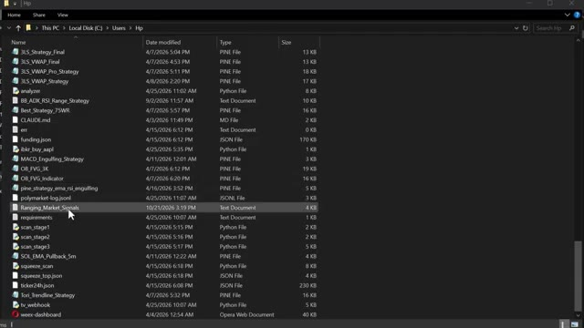
*⏱️ 00:08:25 — Explorateur de fichiers Windows affichant une liste de scripts de trading, notamment des fichiers PINE et Python, avec un fichier 'Ranging_Market_Signals' en surbrillance.*

---

### ⏱️ `[00:08:33 - 00:09:07]` | Segment #19

**🔊 Audio (Transcription Intégrale Mot pour Mot en Français) :**
> Claude a terminé, vous allez voir apparaître un fichier bloc-notes avec tout le code PineScript à l'intérieur. Ouvrez ce fichier, appuyez sur Ctrl plus A pour sélectionner tout le code, puis sur Ctrl plus C pour le copier. C'est tout ce dont vous avez besoin. Maintenant, allons l'importer dans TradingView. Ouvrez TradingView et allez sur n'importe quel graphique. Je vais utiliser à nouveau le Bitcoin et passer l'unité de temps à cinq minutes. Au bas de l'écran, cliquez sur l'onglet de l'éditeur PineScript. Si vous ne le voyez pas, allez dans la barre d'outils inférieure et cliquez sur l'éditeur PineScript. Une fois l'éditeur ouvert, vous y verrez du code par défaut. Sélectionnez-le entièrement et supprimez-le. Ensuite

**👁️ Analyse Visuelle d'Écran (gemini-3.5-flash-lite) :**
**Interface & Outils** : Bloc-notes Windows et plateforme de graphisme financier TradingView.

**Contenu textuel & Code** : Code source Pine Script (gestion des signaux long/short, ADX, Money Flow Index) et graphique en chandeliers japonais de Bitcoin (BTCUSDT).

**Action / Démonstration** : Sélection et copie du code source Pine Script depuis un fichier texte, puis affichage du graphique de trading.

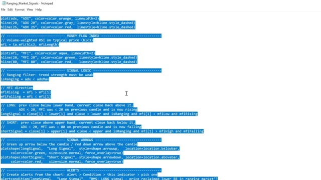
*⏱️ 00:08:41 — Un fichier Bloc-notes contenant du code Pine Script sélectionné en bleu, affichant la logique pour un indicateur de marché en range (Ranging Market Signals).*

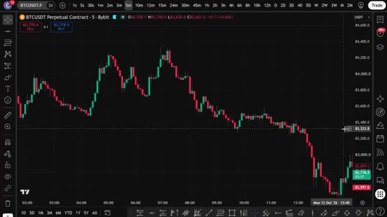
*⏱️ 00:08:50 — Un graphique TradingView affichant l'actif BTCUSDT Perpetual Contract en unité de temps 5 minutes sur la plateforme Bybit.*

---

### ⏱️ `[00:09:07 - 00:09:41]` | Segment #20

**🔊 Audio (Transcription Intégrale Mot pour Mot en Français) :**
> collez le code que Claude vient de vous donner. Maintenant, cliquez sur « Ajouter au graphique ». C’est le bouton en haut à droite de l’éditeur PineScript. TradingView va compiler le script et l’appliquer directement sur votre graphique. Et voilà. Vous pouvez voir les bandes de Bollinger sur le graphique, le panneau ADX, le panneau de l’indice de flux monétaire et les signaux d’achat et de vente tracés automatiquement. Des flèches vertes pour les positions acheteuses, des flèches rouges pour les positions vendeuses. Tout s’exécute exactement de la manière que nous avons configurée manuellement, mais maintenant cela se fait pour vous automatiquement toutes les cinq minutes sur Bitcoin, USDT, ou n’importe quelle paire

**👁️ Analyse Visuelle d'Écran (gemini-3.5-flash-lite) :**
**Interface & Outils** : TradingView (Pine Editor et graphique de trading)

**Contenu textuel & Code** : Code source Pine Script v5 affiché dans l'éditeur à droite (logique de signal, filtres MFI et ADX), et graphique en chandeliers japonais de BTCUSDT avec des bandes de Bollinger et un indicateur personnalisé en bas à gauche.

**Action / Démonstration** : Le curseur de la souris survole le bouton "Publish script" dans l'éditeur Pine Script de TradingView après l'ajout du script au graphique.

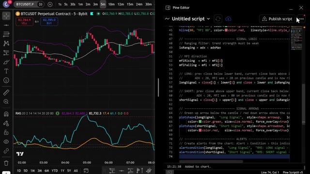
*⏱️ 00:09:16 — Capture d'écran montrant TradingView avec un graphique de prix à gauche et l'éditeur Pine Script à droite.*

---

### ⏱️ `[00:09:41 - 00:10:14]` | Segment #21

**🔊 Audio (Transcription Intégrale Mot pour Mot en Français) :**
> pointé du doigt. Maintenant, pour configurer des alertes, cliquez sur l'icône de réveil en haut de TradingView, sélectionnez « créer une alerte », et dans le menu déroulant des conditions, vous verrez les conditions d'alerte que Claude a ajoutées, signal long et signal court. Configurez-les et TradingView vous avertira dès qu'un signal se déclenche, directement sur votre téléphone. Ainsi, au lieu de surveiller le graphique manuellement, TradingView fait tout le travail pour vous. Dès que toutes les conditions sont réunies, vous recevez une alerte. Vous la vérifiez, vous l'exécutez sur UBIT, et c'est terminé. Maintenant, si vous voulez aller encore plus loin et faire en sorte qu'un trade s'ouvre automatiquement

**👁️ Analyse Visuelle d'Écran (gemini-3.5-flash-lite) :**
**Interface & Outils** : Graphique TradingView (Bybit, BTCUSDT Perpetual Contract, unité de temps 5m) avec la boîte de dialogue « Create alert on » ouverte.

**Contenu textuel & Code** : Boîte de dialogue d'alerte avec les paramètres : Condition (RMS avec paramètres 20, 2, 14, 14, 14, 20, 20, 80), Long Signal sélectionné, Intervalle (Same as chart 5 minutes), Trigger (Once per bar), Message (« RMS: LONG signal - price reclaimed lower B... »).

**Action / Démonstration** : Configuration et paramétrage d'une alerte de trading pour un signal d'achat (Long Signal) sur TradingView.

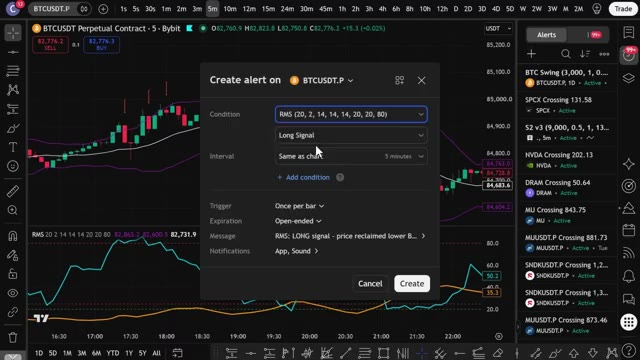
*⏱️ 00:09:49 — Fenêtre de création d'alerte sur TradingView montrant la configuration d'un signal long (« Long Signal ») pour l'indicateur RMS sur le contrat perpétuel BTCUSDT.*

---

### ⏱️ `[00:10:14 - 00:10:36]` | Segment #22

**🔊 Audio (Transcription Intégrale Mot pour Mot en Français) :**
> Sur votre exchange, dès qu'un signal se déclenche, je m'occupe de tout. J'ai créé un groupe privé où je partage tous mes cas d'utilisation pour Claude Code, qu'il s'agisse de l'intégrer à Telegram, TradingView, ou de rechercher des baleines sur Hyperliquid. Tout cela de manière entièrement automatique. Tout ce que je vous ai montré aujourd'hui se trouve dans le groupe. Et j'ajoute constamment de nouvelles choses, de nouvelles stratégies, de nouveaux prompts, de nouvelles intégrations.

**👁️ Analyse Visuelle d'Écran (gemini-3.5-flash-lite) :**
**Interface & Outils** : Whop, TradingView, plateforme de formation personnelle.

**Contenu textuel & Code** : Graphique de prix BTCUSDT.P, indicateur technique personnalisé avec signaux "Buy" et "Sell", liste de fonctionnalités d'automatisation et de contrôle de graphiques par IA.

**Action / Démonstration** : Navigation sur la plateforme de vente, visualisation d'un graphique de trading avec indicateurs et présentation des outils de contrôle de TradingView.

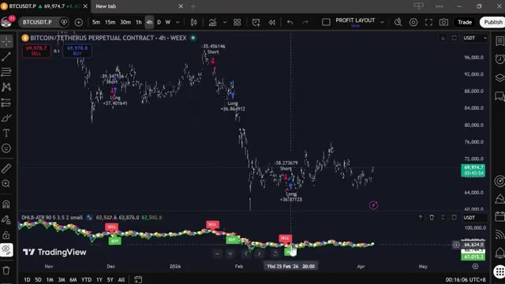
*⏱️ 00:10:25 — Graphique TradingView affichant le contrat perpétuel Bitcoin/Tether (BTCUSDT.P) en unité de temps 4h avec des signaux d'achat et de vente ("Long" et "Short").*

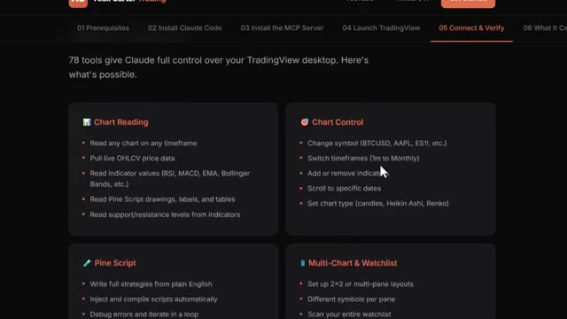
*⏱️ 00:10:30 — Interface de documentation de la formation d'Alex Carter détaillant les fonctionnalités de Claude Code pour contrôler TradingView (Chart Reading, Chart Control, Pine Script, Multi-Chart).*

---

### ⏱️ `[00:10:36 - 00:11:15]` | Segment #23

**🔊 Audio (Transcription Intégrale Mot pour Mot en Français) :**
> Chaque fois que je construis quelque chose de nouveau, ça va directement là-dedans. Le prix est de 79,99 $ par mois. Et honnêtement, quand on y pense, ce que c'est réellement, la configuration de trading par IA la plus avancée disponible pour les traders particuliers en ce moment, constamment mise à jour avec tout inclus à l'intérieur, c'est aussi un cours complet de trading agentique de 2 heures et demie, du débutant à l'expert, aucune base en codage n'est nécessaire, à la fin, vous aurez votre propre système de trading par IA en fonctionnement réel, quelque chose que la plupart des traders particuliers ne savent même pas être possible en ce moment, 79,99 $ par mois, un seul bon trade couvre les frais et les 100 premiers

**👁️ Analyse Visuelle d'Écran (gemini-3.5-flash-lite) :**
**Interface & Outils** : Navigateur web (Whop, site de formation).

**Contenu textuel & Code** : Tarifs d'abonnement, description du cours de trading IA (2.5 heures, 27 modules, intégration Claude, OpenRouter, WEEX, Alpaca, etc.).
[DESC_IMAGE_2] Navigation et présentation de l'offre de formation aux outils de trading par IA.

**Action / Démonstration** : Explications face caméra et analyse conceptuelle des marchés.

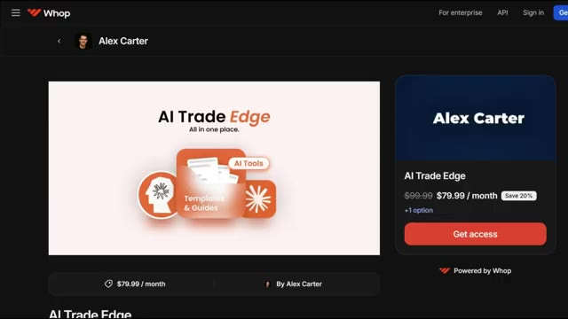
*⏱️ 00:10:46 — Page Whop d'Alex Carter présentant "AI Trade Edge" à 79,99 $ par mois.*

*⏱️ 00:10:55 — Page web du cours complet de trading IA montrant le programme et les outils couverts.*

---

### ⏱️ `[00:11:15 - 00:11:47]` | Segment #24

**🔊 Audio (Transcription Intégrale Mot pour Mot en Français) :**
> les membres bloquent ce tarif définitivement. Après cela, le prix augmente. Le lien est dans la description. Vous ne pouvez vraiment pas vous permettre de rater ça. Et c'est tout les gars. C'est comme ça qu'on prend une stratégie d'Internet. On la donne à Claude et on obtient un script Pine fonctionnel sur TradingView. Pas de codage, pas de surveillance manuelle des graphiques. Si vous voulez voir une démo complète de la façon dont je trade en utilisant seulement mon Telegram et la démo complète de tous les cas d'utilisation sur TradingView, cliquez sur la vidéo qui apparaît à l'écran dès maintenant. Si vous avez trouvé cela utile, laissez un pouce bleu. Ça aide vraiment la chaîne. Abonnez-vous si vous

**👁️ Analyse Visuelle d'Écran (gemini-3.5-flash-lite) :**
**Interface & Outils** : TradingView, Terminal de commandes / Script CLI.

**Contenu textuel & Code** : Bandes de Bollinger, RSI (14), PnL clôturé (195,4), rapport d'analyse multi-timeframe (Weekly, Daily, 4-Hour, 1-Hour), niveaux clés (supports/résistances) et recommandations d'entrée/stop loss/take profit.

**Action / Démonstration** : Analyse technique d'un graphique de trading et affichage d'un rapport de confluence multi-timeframe généré par script.

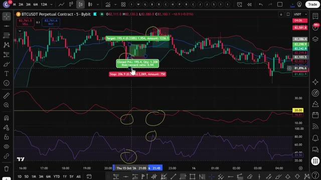
*⏱️ 00:11:23 — Graphique TradingView affichant le contrat perpétuel BTCUSDT avec des indicateurs de bandes de Bollinger, RSI et des annotations de PnL.*

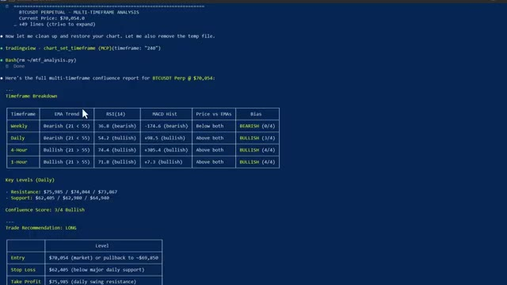
*⏱️ 00:11:39 — Terminal de commande affichant un rapport d'analyse multi-timeframe pour BTCUSDT avec des tableaux de tendance et des recommandations de trade.*

---

### ⏱️ `[00:11:47 - 00:11:50]` | Segment #25

**🔊 Audio (Transcription Intégrale Mot pour Mot en Français) :**
> l'avez pas déjà fait et je vous vois dans la prochaine.

**👁️ Analyse Visuelle d'Écran (gemini-3.5-flash-lite) :**
**Interface & Outils** : Aucune interface visible.

**Contenu textuel & Code** : Aucun contenu informatif ou technique affiché.

**Action / Démonstration** : Aucune action ou manipulation visible.

---

